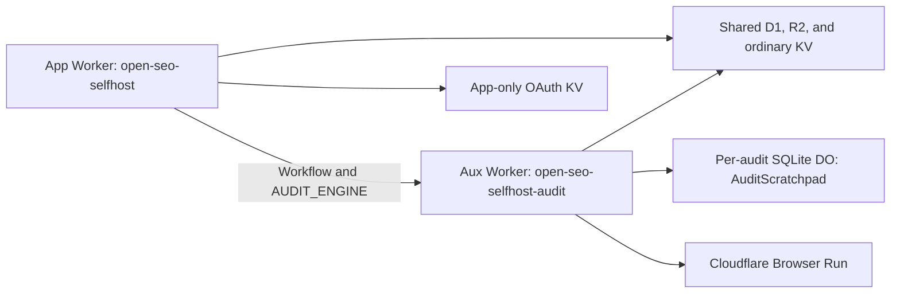

# OpenSEO Operational Skills (`openseo-ops`)

**Canonical Skill Location:** `%OneDrive%\MD\SKILLS\openseo-ops\SKILL.md`  
**Target Platform:** OpenSEO (`https://seo.codev.id`)  
**Active Repository:** `C:\Users\THINKPAD\Documents\GitHub\seo.codev.id` (Branch: `main`)  
**Deployment Infrastructure:** Cloudflare Workers & Pages via Alchemy v2  
**Target Organization:** `shared-workspace`  
**Primary Database:** Cloudflare D1 `open-seo-db-selfhost` (UUID: `b11700fc-47e9-4eb3-a323-a024d7a2fbaa`)  
**Auxiliary Audit Worker:** `open-seo-selfhost-audit` (Engine for `SiteAuditWorkflow` & `AuditScratchpad` DO)  

---

## 1. System Topology & Dual-Worker Architecture

OpenSEO on `seo.codev.id` operates on an edge-native, decoupled dual-worker topology deployed through **Alchemy v2**:



### 1.1 App Worker (`open-seo-selfhost`)
- Handles incoming user requests, TanStack Router server-side rendering, and `/onsite` Aggregated Fleet View.
- Serves the native MCP endpoint at `https://seo.codev.id/mcp` with **78 registered tools** across 8 capability families.
- Authenticated at the edge:
  - **Self-Hosted Production (`AUTH_MODE=cloudflare_access`)**: Protected by Cloudflare Zero Trust Access Google SSO (Tier 1 Owner-Only). Browser users sign in via Google OAuth. Headless MCP clients authenticate by passing an authenticated session token via cookie (`Cookie: CF_Authorization=<token>`). Cloudflare Access edge verifies this session and passes the signed JWT assertion (`Cf-Access-Jwt-Assertion` containing valid nonempty `sub` and `email` identity claims) to the origin Worker. The repository origin verifier requires these explicit `sub` and `email` claims; Service Token authentication workflows require a dedicated Service Auth policy and separately configured/verified Stage 2 identity admission.
  - **Local Development / Test Runner (`AUTH_MODE=local_noauth`)**: Trusted local no-auth environment on `localhost:3001` (Vite dev server default) or in-memory mocks. Local Wrangler workflow dispatch defaults to port `8787`.
  - **Hosted Production Mode**: Authenticated via personal API keys (`oseo_...` via `Authorization: Bearer <key>` or `x-api-key`) or OAuth bearer tokens.
- App worker exclusively binds `OAUTH_KV` (`open-seo-oauth-kv-selfhost`) for MCP client registrations and OAuth refresh tokens.

### 1.2 Auxiliary Audit Worker (`open-seo-selfhost-audit`)
- Runs the heavy crawl and Lighthouse workflows isolated from the main app to prevent isolate memory exhaustion (OOM) on large sites.
- Implements `SiteAuditWorkflow` and the `AuditScratchpad` SQLite-backed Durable Object.
- Shared storage: Binds to the same D1 (`open-seo-db-selfhost`), R2 (`open-seo-r2-selfhost`), and KV (`open-seo-kv-selfhost`) as the main app.
- Owns the `BROWSER` binding (Cloudflare Browser Run) for rendered audits. Takes no direct public traffic (`url: false`).

---

## 2. Fleet Management & Aggregated Fleet Observability (`/onsite`)

The Aggregated Fleet View provides helicopter observability across Syamsul Alam's portfolio of **87 commercial properties**.

### 2.1 Database Schema for Fleet Management
Fleet state is partitioned across 10 dedicated D1 tables in `src/db/fleet.schema.ts`:
1. `fleet_roster_versions`: Version-controlled manifest snapshots (`id = 'roster-shared-workspace-2026-11-22-v1'`).
2. `fleet_roster_members`: The 87 canonical properties, bound by `canonical_host`, `category`, `tier`, `site_intent`, and `project_id`.
3. `fleet_runs`: Records fleet-wide audit batches and runs (`requester_id` NOT NULL).
4. `fleet_run_items`: Individual domain audit evaluation tasks within a run (`primary_series_key = 'diagnostic'` or `'weekly-baseline'`).
5. `fleet_snapshots`: Stored scoring snapshots and subscore pillars (`series_key = 'diagnostic'` or `'weekly-baseline'`).
6. `fleet_rule_results`: Detailed granular rule pass/fail/unknown counts.
7. `fleet_issue_occurrences`: Fingerprinted issues grouped across URLs and shared templates.
8. `fleet_change_events`: Production deployment events and Git commit provenance.
9. `fleet_change_verifications`: Causal attribution (`pending`, `verified_improved`, `verified_regressed`, `inconclusive`, `expired`).
10. `fleet_remediation_jobs`: One-click remediation packets bound to sovereign skills.

### 2.2 Status Taxonomy & Badge Precedence
Every domain in `/onsite` displays one of 7 mutually exclusive status badges evaluated with strict precedence via `deriveDisposition` (`src/server/features/fleet/services/fleetCalculations.ts:276–345`):
```text
unmapped → exempt → unavailable → terminal partial (fresh_partial or stale)
  → no/mismatched observation (never_audited) → stale → fresh_graded or fresh_partial
```
1. `Unmapped`: Domain exists in `fleet_roster_members`, but `project_id` is NULL.
2. `Exempt`: Intentionally excluded from automated fleet crawls (e.g. Tier 4 parked domains).
3. `Unavailable`: Latest attempt failed, crashed, errored, or finalized without an admitted observation snapshot (`status: "unavailable"`). Displays score `—` (distinguished from measured 0%).
4. `Terminal Partial`: Audit completed with partial evidence coverage between $80\%$ and $<100\%$, displayed as provisional interval $[L, U]$ when reconciled bounds exist from admitted observation evidence.
5. `Never Audited`: Linked to an active project in `projects`, but no completed audit attempt exists.
6. `Stale`: Previous audit completed, but results exceed the 10-day TTL freshness window.
7. `Graded`: Audit completed with 100% evidence coverage within the 10-day TTL window (or provisional when partial coverage reconciles).

**Interval Display Contract**: Provisional interval $[L, U]$ is a rendering presentation rule displayed if and only if:
1. Reconciled evidence coverage satisfies $80\% \le C < 100\%$.
2. Validated earned mass $L$ gives upper bound $U = L + 100 - C$, subject to a confirmed critical incident cap of 59.
Missing stored endpoints can be derived. Invalid or contradictory evidence displays as `—` (unavailable/incomplete). A partial status can have less than 80% coverage and a stale result may retain a valid interval. Full point scores require exactly $C = 100\%$ qualified evidence. Freshness evaluation (10-day TTL window) and unavailable precedence operate independently of interval display eligibility.

**10-Day Freshness Window vs. 21-Day Trend Comparability Window**:
- **10-Day Freshness Window (`FRESHNESS_WINDOW_MS = 10 * 86_400_000`)**: Evaluates status badge freshness. Completed audits older than 10 days receive the `stale` badge on `/onsite`.
- **21-Day Comparability Window (`COMPARABLE_BASELINE_WINDOW_MS = 21 * 86_400_000`)**: Governs historical trend comparability in `fleet_change_verifications` and delta tracking. Two baseline snapshots can only be compared for causal attribution (improvement or regression) if their observation gap is $\le 21$ days and share the verified comparability key and rubric. Gaps exceeding 21 days return `null` (baseline expired). (Note: change-verification and remediation tables represent schema in the topology; automated causal attribution is not an exposed runner workflow).

**Critical Incident Cap**: Requires qualified confirmation (`parseIncidentConfirmation` in `fleetEvidence.ts`) with essential failure codes (DNS failure, TLS failure, origin connection drops), verified expected intent, independent corroboration probe, and finite confirmation timestamps. Validated incidents cap the maximum score at **59 (F)** with a critical incident badge.

### 2.3 Canonical Rubric v1 Scoring Engine
Health scores (0–100) are evaluated across 6 weighted pillars matching source constants in `src/server/features/fleet/services/fleetConstants.ts`:

| Pillar | Weight | Schema Column in `fleet_snapshots` | Key Metrics Evaluated |
|---|---|---|---|
| **Technical** | 35% | `score_technical` | HTTP 4xx/5xx errors, redirect chains, canonical integrity, response time. |
| **Internal Links** | 20% | `score_internal_links` | Broken internal links, orphan pages, crawl depth $\le 3$, anchor text distribution. |
| **Mobile & Lab Perf** | 15% | `score_mobile_perf` | Pinned mobile Lighthouse profile: LCP (50%), CLS (30%), TBT (20%). |
| **On-Page SEO** | 15% | `score_on_page` | Title tags, meta descriptions, H1 hierarchy, thin content detection. |
| **Schema & Structured Data** | 10% | `score_schema` | JSON-LD schema validity, OpenGraph, Twitter Cards. |
| **AI Search Readiness** | 5% | `score_ai_readiness` | 40-word direct answers, answer-first chunking, factual grounding for GEO/AEO. |

**Series Separation**:
- `'weekly-baseline'`: Consumed by the `/onsite` dashboard for official fleet score display and weekly trend comparisons. Official weekly baseline grading is published by a dedicated external aggregate grading service (not emitted by local CLI or single-site MCP runs).
- `'diagnostic'`: Dedicated isolated series for host-side GitHub Direct Audits (`run-github-fleet-audit.ts`), preserving baseline score integrity without polluting weekly historical trends.

---

## 3. Site Audit Operations: Dual-Lane Audit Model

OpenSEO operates on a **Dual-Lane Audit Architecture**:

### Lane 1: Commit-Pinned GitHub Direct Audit Engine (`run-github-fleet-audit.ts`) — Primary Source Diagnostic Lane
- **Purpose**: Rapid, high-volume static source inspection directly from GitHub repositories without Worker isolate memory ceilings.
- **Commit Pinning**: Resolves target branch to an immutable commit SHA (`gh api /repos/:owner/:repo/commits/:branch`). All Git tree queries and blob reads are bound to this commit.
- **Git Tree Discovery**: Retrieves up to 100,000 files in a single atomic call (`GET /repos/:owner/:repo/git/trees/:commitSha?recursive=1`), bounded by GitHub API's 100,000 entry and 7 MB response payload cap. Fails fast if `truncated: true` (requiring recursive subtree enumeration).
- **Zero Edge Heap Pressure**: HTML parsing, heading extraction, meta tag inspection, and OpenGraph analysis execute host-side in Node.js, completely bypassing Cloudflare Workers Free Tier 128 MB isolate memory ceiling.
- **In-Memory Link Graph Validation**: Maps repository file paths to canonical served identities (including directory `/index.html` $\leftrightarrow$ `/index.htm` $\leftrightarrow$ `/` and extensionless routes). Resolves internal `<a href="...">` links against the known route set using unified route indexing and domain host equivalence (supporting HTTP/HTTPS and apex/www pairs on default ports 80/443) to detect broken links and orphan pages with zero network calls.
- **Staged D1 Persistence**:
  1. Inserts parent audit in `running` phase with `github-audit-${auditId}` instance ID via atomic conditional insert that prevents concurrent double-reservation and auto-reclaims stale orphaned runs (> 2h old).
  2. Ingests pages and issues in bounded $\le 9$-statement chunks ($\le 14,999$ UTF-8 bytes total per serialized batch envelope, strictly respecting Windows CreateProcessW 30,000 character limits). Binds string fields to safe character limits and serialized byte limits ($\le 10,000$ bytes per page statement) and detailsJson to bounded UTF-8 bytes (max 3,499) preserving valid structured JSON.
  3. Guards child writes so that `audit_pages` and `audit_issues` only insert when the parent audit is `status = 'running'`, and validates that issue `page_id` references belong to the same attempt.
  4. Verifies child row count integrity and asserts zero orphaned page references before the final atomic compare-and-set UPDATE with `RETURNING id`.
  5. On count mismatch, invalid child references, or state conflict, throws immediately. Incomplete source acquisition ends with audit status `failed` and an isolated diagnostic item which can be `partial` (they are distinct).
- **Diagnostic Fleet Series Integration**: Writes `fleet_runs` (`requester_id = 'github-audit-runner'`), `fleet_run_items` (`primary_series_key = 'diagnostic'`), and `fleet_snapshots` (`series_key = 'diagnostic'`, unmeasured pillars `NULL`). Reused audits strictly verify the exact triple (`r.status = 'completed'`, `fri.status = 'completed'`, matching `project_id`, matching `member_id`, and exactly 1 verified diagnostic attempt per member) bound to the effective roster version; repair failures abort without falling back to a redundant Git crawl.
- **Evidence Boundary**: Records source-only evidence. Unmeasured runtime properties (`status_code`, `response_time_ms`, `crawl_depth`) remain `NULL` and `in_sitemap` is `0`. Runtime-only issue reporters (`deep-page`, `slow-response`) are excluded.

### Lane 2: Edge HTTP Workflow Crawler (`SiteAuditWorkflow`) — Live Runtime & Fleet Grading Lane
- **Purpose**: Full live HTTP validation, external third-party crawls, robots.txt enforcement, and real edge TTFB latency measurement. (Note: neither `run-fleet-audits.ts` nor `run_site_audit` publishes official weekly fleet snapshots; official weekly baseline grading is reserved for dedicated aggregate grading publishers).
- **Control Plane (`SiteAuditWorkflow`):** Cloudflare Workflow managing phase ordering, retries, and failure states on `open-seo-selfhost-audit`.
- **Data Plane (`AuditScratchpad`):** SQLite-backed Durable Object instance per audit (`idFromName(auditId)`). Manages URL frontier leases in chunks of up to 200 URLs (`CHUNK_SIZE = 200`), with a 90-second soft discovery/crawl cutoff for starting new fetches, and 25-page persistence blocks after initial block.
- **Limits, Defaults & Robots Scope**: Edge crawler defaults to 500 pages (max 10,000 for self-hosted instances) and concurrency 2 (allowed range 1–5), requiring exactly one execution scope (`--domain`, `--all`, or `--limit`). Respects `robots.txt` disallow rules and hostname boundaries. Fleet edge CLI hard-codes `renderJavaScript: false`. JavaScript-rendered crawls up to 1,000 pages (`RENDERED_MAX_AUDIT_PAGES`) via Cloudflare Browser Run require the UI or single-site MCP input. When the 15-minute polling deadline is exceeded on in-flight audits, admission pauses to protect concurrency slots; if an in-flight audit exceeds 20 minutes (15m pause + 5m overdue drain), the runner terminates queue drain.

---

## 4. Operational Playbooks: Fleet & Site Audit

### Playbook 1: Roster Enrollment & Turnkey Linking
**Prerequisites & Environment Architecture**:
- **Organization Bootstrap Prerequisite**: The parent organization row (`id = 'shared-workspace'`) must exist in D1 before importing rosters to satisfy foreign key constraints. Note that the normal local delegated authentication session resolves to a per-user personal organization (`user_<id>`); MCP callers without `shared-workspace` will receive an organization constraint error when calling fleet tools. For local fleet development, use the direct local CLI or provision a fixture session with `shared-workspace`.
- **Three-Role Execution Topology**:
  - **Role 1 (App HTTP / MCP)**: Vite dev server on port `3001` (`pnpm run dev`) or app Wrangler dev serving UI routes and `/mcp`.
  - **Role 2 (Auxiliary Audit Worker)**: Auxiliary worker on port `8787` (`pnpm exec wrangler dev --config wrangler.audit.jsonc --local --port 8787`) managing Cloudflare Workflows and the local Workflows control API. Note that the auxiliary worker returns 404 for general HTTP fetches; its sole purpose is workflow execution.
  - **Role 3 (Direct Host CLI)**: Local and remote CLI execution against D1 via Wrangler (`--local` or `--remote`), sharing the local persistence root at `.wrangler/state/v3/d1`. Note environment precedence: `.env.selfhost` overlays local process environment, with populated values winning over default configuration files. Ambient `gh api` uses ambient GitHub CLI authentication, while the repository runner's raw download fallback inspects `GITHUB_TOKEN` and `GH_TOKEN`.
- **Cloudflare Access Two-Stage Authentication**: Edge access is governed by the Cloudflare Access session cookie at the public edge boundary, while the worker validates the signed `Cf-Access-Jwt-Assertion` header, mapping verified identity to user records before enforcing organization authorization.
- **Approval Protocol**: Approval JSON requires canonical schema fields: `organizationId`, `versionTag`, `rosterPlanSha256`, `approvedBy`, and optional `approvedAt` (ISO timestamp).
- **Importer Semantics**: Importer execution (`import-fleet-roster.ts`) has local-only semantics (runs against local D1 `DB`). To compute the canonical roster plan SHA-256 for the approval file without mutating D1:
  ```powershell
  node --import tsx --input-type=module -e 'import {hashCanonicalRosterPlan} from "./scripts/import-fleet-roster.ts"; import {FLEET_MANIFEST_MEMBERS} from "./src/server/features/fleet/data/fleetManifest.ts"; console.log(hashCanonicalRosterPlan("shared-workspace", FLEET_MANIFEST_MEMBERS))'
  ```
- **Turnkey Fleet Linking**: Fleet linking (`link-github-fleet.ts`) defaults to local D1 (`DB`); pass `--remote` for remote production D1 (`open-seo-db-selfhost`), scoped via `--org-id` (default `shared-workspace`). It requires an existing effective approved roster in D1 (`approved_at IS NOT NULL AND julianday(approved_at) <= julianday('now')`). Always preview mutations with `--dry-run` before applying live. (Note: legacy `generate-fleet-linking-sql.ts` is retired).
- **Recency Filter Bypass**: In `run-fleet-audits.ts`, passing `--domain <host>` targets that domain exclusively and completely bypasses the 10-day recency cutoff filter, whereas `--all` and `--limit` filter out domains audited within the last 10 days unless `--no-skip-recent` is passed.

For fresh **local development** (`localhost:3001` / `wrangler dev` on `8787`):
```powershell
# 1. Apply local migrations to local D1 (DB)
pnpm exec wrangler d1 migrations apply DB --local

# 2. Import approved roster into local D1
$approvalFile = "path/to/approval.json"
pnpm exec tsx scripts/import-fleet-roster.ts shared-workspace --approval "$approvalFile"

# 3. Preview turnkey linking plan (validates unmapped projects and calculates required links)
pnpm exec tsx scripts/link-github-fleet.ts --dry-run

# 4. Execute turnkey linking against local D1
pnpm exec tsx scripts/link-github-fleet.ts
```

For **remote production D1** (`open-seo-db-selfhost` on Cloudflare edge):
```powershell
# Preview turnkey fleet linking plan across all portfolio targets and roster members (dry-run)
pnpm exec tsx scripts/link-github-fleet.ts --remote --dry-run

# Execute turnkey fleet linking against live remote D1 with post-apply roster supersession checks
pnpm exec tsx scripts/link-github-fleet.ts --remote
```

> [!NOTE]
> The linker's `--dry-run` flag operates as a read-only execution plan preview that computes missing projects and link updates without mutating D1. Full database integrity assertions (zero unmapped, zero invalid links) and post-apply roster supersession checks run on live execution passes to confirm state convergence.

### Playbook 2: Fleet Operations Architecture & Entry Point Matrix

| Entry Point | Backend Engine | Target Population | Scope Selector | Default Destination | Authentication & Credential Lane | Data & Side Effects |
|---|---|---|---|---|---|---|
| `run-github-fleet-audit.ts` | Host Node.js | Active Approved Fleet Roster (or `--workspace` for wider inventory) | `--domain <host>`, `--limit <n>`, `--all` | Remote D1 (`open-seo-db-selfhost`) or `--local` | GitHub token (`gh auth token` or `GITHUB_TOKEN`), Cloudflare Wrangler D1 | Inserts `audits`, `audit_pages`, `audit_issues`; writes diagnostic series (`fleet_runs`, `fleet_run_items`, `fleet_snapshots`) |
| `run-fleet-audits.ts` | Cloudflare Workflows | Active Workspace Projects in `shared-workspace` (with 10-day TTL filter) | `--domain <host>`, `--limit <n>`, `--all` | Remote D1 (`open-seo-db-selfhost`) or `--local` | Wrangler D1 / Cloudflare OAuth | Inserts `audits`, spawns `SiteAuditWorkflow` instances, polls to completion |
| `get_fleet_issues` (MCP) | Cloudflare Worker MCP Handler | Active Workspace Projects in `shared-workspace` | `domain`, `severity`, `issueType`, `source`, `limit` | Current DB Binding | Cloudflare Access JWT or Google SSO Session | Read-only query; aggregates issues across latest audits and maps to remediation skills |
| `run_fleet_audit` (MCP) | Cloudflare Worker MCP Handler | Enrolled Roster & Active Projects in `shared-workspace` | `domain`, `limit`, `all`, `mode` | Current DB Binding | Cloudflare Access JWT or Google SSO Session | Read-only planning; outputs executable `pnpm` CLI argv and plan ID |

### Playbook 2A: Executing Commit-Pinned GitHub Repository Audit (Primary Source Lane)
Direct audit accepts exactly one execution scope (`--domain <canonical-host>`, `--limit <n>`, or `--all`). By default, bulk audit admits properties from the approved fleet roster; pass `--workspace` to audit wider inventory projects.
- **Max Pages Parameter (`--max-pages <n>`)**: Allowed range 1–10,000, default 10,000. Setting a cap below the total eligible pages yields incomplete source coverage.
- **Audit Reuse vs. Repair**: When auditing without `--force`, completed source audits with valid diagnostic triples (`fleet_runs`, `fleet_run_items`, `fleet_snapshots`) bound to the effective roster version are reused; if diagnostic rows are missing for an approved roster member, a targeted diagnostic repair occurs without re-crawling Git. Workspace audits outside the approved roster bypass diagnostic repair requirements.
- **Archive Benchmark (`benchmark-archive-audit.ts`)**: Supports `--domain <host>` (manifest-backed lookup), `--repo <owner/repo>`, and `--root <path>` (publish root, defaults to manifest or `.`), with default target `cfpages-adistyputriharli/Concrete.co.id`. Measures true cryptographic candidate parity, selective blob vs. tarball response body bytes, and memory delta (end-minus-start RSS).
- D1 target defaults to `--remote` (`open-seo-db-selfhost`); pass `--local` for local D1 (`DB`).
```powershell
# Audit a single property by exact domain directly from its GitHub repository (Selective Blob Lane)
pnpm exec tsx scripts/run-github-fleet-audit.ts --domain concrete.co.id

# Streamed tarball archive mode for repositories without heavy binary assets
# (Enforces 100 MiB compressed, 250 MiB expanded, and 10 MiB per-entry caps with verified raw fallback)
pnpm exec tsx scripts/run-github-fleet-audit.ts --domain concrete.co.id --archive

# Local D1 execution pass
pnpm exec tsx scripts/run-github-fleet-audit.ts --domain concrete.co.id --local

# Force re-audit bypassing source reuse on identical commit
pnpm exec tsx scripts/run-github-fleet-audit.ts --domain concrete.co.id --force

# Benchmark Selective Blob vs. Tarball Archive lane performance with verified blob acquisition
# (Covers archive acquisition, candidate extraction under publish root, and raw fallback recovery)
pnpm exec tsx scripts/benchmark-archive-audit.ts --domain concrete.co.id
pnpm exec tsx scripts/benchmark-archive-audit.ts --repo cfpages-adistyputriharli/Concrete.co.id --root .

# Audit a bounded slice of candidate portfolio properties (limits both repairs and fresh audits)
pnpm exec tsx scripts/run-github-fleet-audit.ts --limit 20 --max-pages 10000

# Audit wider workspace inventory outside approved fleet roster
pnpm exec tsx scripts/run-github-fleet-audit.ts --all --workspace
```

### Playbook 2B: Triggering Edge Site Audits & Batch Fleet Crawls (Live Runtime Lane)
For live HTTP validation across deployed sites, dispatch via the CLI edge runner, `AuditService.startAudit`, or MCP `run_site_audit`:

> [!NOTE]
> The edge runner (`run-fleet-audits.ts`) creates site-audit rows and dispatches the live crawler workflow (`SiteAuditWorkflow`). Output from edge crawls represents site-audit instances; official weekly baseline grading (`weekly-baseline` series) is reserved for dedicated aggregate grading publishers.
> **Lifecycle, Defaults & Drain**:
> - Directly invoked edge CLI defaults to 500 pages (max 10,000 for self-hosted instances) and selects `auto` Lighthouse, with concurrency 2 (allowed range 1–5), requiring exactly one execution scope (`--domain`, `--all`, or `--limit`).
> - In contrast, the single-site MCP tool (`run_site_audit`) defaults to 50 pages and leaves Lighthouse off.
> - **Drain & Pause Window**: When in-flight audits exceed the 15-minute deadline, new admissions pause to protect the concurrency window. The runner allows a bounded 5-minute overdue drain (20 minutes total from start); if active workflows fail to terminate within the 20-minute limit, the command logs active and undispatched counts and exits with failure code 1.
> - **Local Operation**: When running locally, `--local` requires a running local dev session (`wrangler dev` on port `8787`). `--no-skip-recent` overrides the 10-day recency cutoff filter.

```powershell
# Run Cloudflare Workflows live HTTP crawler across target domain
pnpm exec tsx scripts/run-fleet-audits.ts --domain concrete.co.id --max-pages 500

# Run workflow crawler across candidate fleet projects with concurrency window (override recency check)
pnpm exec tsx scripts/run-fleet-audits.ts --limit 10 --concurrency 2 --no-skip-recent

# Local development dispatch (requires local dev session running on port 8787)
pnpm exec tsx scripts/run-fleet-audits.ts --domain concrete.co.id --local
```

Programmatic dispatch via `AuditService.startAudit` (internal server call) or MCP input:

**Internal Server Call (`AuditService.startAudit`)**:
```typescript
await AuditService.startAudit({
  projectId: "<project-uuid>",
  startUrl: "https://concrete.co.id",
  actorUserId: "user_123",
  billingCustomer: {
    userId: "user_123",
    userEmail: "admin@codev.id",
    organizationId: "shared-workspace",
    projectId: "<project-uuid>",
  },
  limitTier: "self_hosted",
  maxPages: 2000,
  renderJavaScript: false,
  lighthouseStrategy: "none",
});
```

**MCP Tool Input Schema (`run_site_audit`)**:
```json
{
  "projectId": "<project-uuid>",
  "url": "https://<domain>/",
  "maxPages": 50,
  "renderJavaScript": false,
  "runLighthouse": false
}
```

### Playbook 2C: Fleet-Wide Issue Triage & CSV Export
Queries the latest completed audit per active project, ordering by severity priority (critical $\rightarrow$ warning $\rightarrow$ info) then domain and issue ID:
```powershell
# List top aggregated issues across all fleet audits with sovereign skill routing (default limit 200, max 1000)
# Supports --local (local SQLite D1 fixture) or default remote D1 execution
pnpm exec tsx scripts/fleet-issues.ts --limit 50
pnpm exec tsx scripts/fleet-issues.ts --local --limit 50

# Filter issues by exact domain, severity, issue type, and source lane (--source all|edge|repository|both)
pnpm exec tsx scripts/fleet-issues.ts --domain concrete.co.id --severity critical --type broken-internal-link --source all

# Output formats: JSON payload or RFC 4180 CSV with formula escaping (when both --csv and --json are passed, --csv takes precedence)
pnpm exec tsx scripts/fleet-issues.ts --domain concrete.co.id --json
pnpm exec tsx scripts/fleet-issues.ts --csv fleet-issues.csv
```

#### Shipped Sovereign Skill Remediation Routing Map (`src/server/lib/audit/issue-routing.ts`)
| Issue Category / Type | Sovereign Skill Route | Operational Remediation Protocol |
|---|---|---|
| `canonical-mismatch`, `orphan-page`, `broken-internal-link` (page targets) | `/internal-linking` | Update internal link graph, add contextual breadcrumbs, resolve dead internal routes with live indexable URLs. |
| Broken assets (CSS, JS, fonts), asset-like internal links | `/static-site-css-repair` | Verify static export assets, repair relative paths, fix missing CSS stylesheets and scripts. |
| `missing-title`, `missing-meta-description`, `missing-h1`, `thin-content` | `/unslop-seo` | Strip AI writing fluff, inject 40-word direct answers, write unique high-density titles/meta descriptions. |
| `slow-page`, `poor-lcp`, `poor-cls`, `high-tbt`, `crawl-rate-limited` | `/web-perf` | Optimize asset delivery, reduce bundle sizes, eliminate render-blocking resources. |
| `broken-external-link`, `redirect-3xx`, `server-error-5xx`, default | `/seo-audit` | Replace or prune dead third-party outbound links, resolve origin HTTP 5xx responses. |

### Playbook 2D: Programmatic Fleet Operations via MCP
```typescript
// Query fleet aggregated issues with skill routing (evaluates latest completed audit per active project, partitioned by source)
// Source lane partitioning:
// - 'edge': selects newest completed edge audit per project (workflow_instance_id NOT LIKE 'github-audit-%' OR NULL)
// - 'repository': selects newest completed direct repository audit per project (workflow_instance_id LIKE 'github-audit-%')
// - 'all' / 'both': selects the union of newest edge audit AND newest repository audit for each active project
// Limit parameter: default 50, permitted 1–200. Domain must be a valid canonical lowercase hostname.
const issuesResult = await client.callTool({
  name: "get_fleet_issues",
  arguments: { domain: "concrete.co.id", severity: "critical", issueType: "broken-internal-link", source: "all", limit: 20 },
});

// Generate execution plan for fleet audit (read-only planning tool; emits structured argv and planId without dispatching)
// Scope Selector Contract: Requires EXACTLY ONE scope selector: `domain`, `limit` (1–100), or `all: true`.
// Omitting `domain` does NOT implicitly emit --all; it fails with an explicit scope requirement error.
// Parameters and Bounds:
// - mode: 'repository_direct' (default) or 'edge_workflow'
// - maxPages: integer between 10 and 10,000 (default 2000)
// - concurrency: integer between 1 and 5 (default 2, emitted ONLY in edge_workflow mode)
// - limit: integer between 1 and 100 (when using limit selector)
// Emitted executionCommand targets default remote D1 (open-seo-db-selfhost).
const auditPlan = await client.callTool({
  name: "run_fleet_audit",
  arguments: { domain: "concrete.co.id", mode: "edge_workflow", maxPages: 2000, concurrency: 2 },
});
console.log("Plan ID:", auditPlan.structuredContent?.planId);
console.log("Execution argv:", auditPlan.structuredContent?.argv);
```

### Playbook 2E: Fleet Telemetry & Inventory Inspection
```powershell
# View fleet status summary with mutually exclusive coverage stats (completed, running, failed, never_audited)
# Supports --local or default remote D1 execution
pnpm exec tsx scripts/fleet-status.ts
pnpm exec tsx scripts/fleet-status.ts --local

# Reconcile enrolled roster members against active projects and completed audit IDs via remote D1
# check-fleet-repos.ts queries remote D1 projects and audits directly; it makes ZERO live GitHub API calls.
pnpm exec tsx scripts/check-fleet-repos.ts --remote

# Local D1 coverage check (human-readable)
pnpm exec tsx scripts/check-fleet-repos.ts --local

# Local D1 coverage check as JSON
pnpm exec tsx scripts/check-fleet-repos.ts --local --json
```
> [!NOTE]
> The coverage report denominator evaluates enrolled active members of the effective approved roster version (`m.version_id = effectiveRoster.id AND m.enrollment_state = 'active'`). Properties in `exempt` or `parked` states remain in roster records but are excluded from active audit requirements, while `excluded` properties are kept outside the dashboard population entirely. A partial status can result from a partial attempt or insufficient evidence for an official grade; an interval is rendered only when reconciled evidence satisfies 80% <= coverage < 100% and bounds agree with earned mass (otherwise displayed as `—`). Full point scores require exactly 100% qualified evidence coverage. Status badge freshness (10-day TTL) and historical trend comparability (21-day window) operate independently of interval display eligibility.

### Playbook 3: Monitoring Workspace Audit Execution in Remote D1
To inspect real-time crawler progress and audit state using workspace-scoped predicates:
```powershell
npx wrangler d1 execute open-seo-db-selfhost --remote --command "
  SELECT a.id, p.domain, a.status, a.pages_crawled, a.pages_total,
         a.error_code, a.current_phase, a.started_at 
  FROM audits AS a
  JOIN projects AS p ON p.id = a.project_id
  WHERE p.organization_id = 'shared-workspace' AND p.archived_at IS NULL
  ORDER BY julianday(a.started_at) DESC NULLS LAST, a.id DESC 
  LIMIT 10;
"
```

### Playbook 4: Self-Host Deployment Pipeline (Alchemy v2)
Scope `deploy:selfhost` to an authorized live production release. The package script builds and deploys through Alchemy; Stage 1 code review and unit test fixtures have no reason to execute it:
```powershell
# Executes preflight validation, vite build --mode selfhost, typecheck, and alchemy deploy to live production
pnpm run deploy:selfhost
```

### Playbook 5: Programmatic Headless MCP Client Operations
In self-hosted deployments (`AUTH_MODE=cloudflare_access`), headless agents connect using `StreamableHTTPClientTransport` with the authenticated session cookie lane:
```typescript
import { Client } from "@modelcontextprotocol/sdk/client/index.js";
import { StreamableHTTPClientTransport } from "@modelcontextprotocol/sdk/client/streamableHttp.js";

const client = new Client({ name: "openseo-fleet-operator", version: "1.0.0" }, { capabilities: {} });
const accessSession = process.env.CF_ACCESS_SESSION;
if (!accessSession) throw new Error("Missing Cloudflare Access session token (CF_ACCESS_SESSION)");

const transport = new StreamableHTTPClientTransport(
  new URL("https://seo.codev.id/mcp"),
  {
    requestInit: {
      headers: {
        // Authenticated Cloudflare Access Google SSO session token (cookie lane)
        Cookie: `CF_Authorization=${accessSession}`,
      },
    },
  }
);

await client.connect(transport);
try {
  // Discover available tools across all 78 registered tools
  const tools = await client.listTools();
  console.log(`Discovered ${tools.tools.length} MCP tools`);

  // Call list_projects within the admitted workspace
  const projects = await client.callTool({ name: "list_projects", arguments: {} });
  console.log("Active projects:", projects);
} finally {
  await client.close();
}
```

> [!NOTE]
> **Authentication & Local Topology**:
> - **Public Client Edge Access**: Pass authenticated Google SSO session via `Cookie: CF_Authorization=<token>` header to `https://seo.codev.id/mcp`.
> - **Service-to-Service Origin Auth**: Pass a signed `Cf-Access-Jwt-Assertion` header containing valid `sub` and `email` identity claims.
> - **Local Offline Development**:
>   - **App UI & MCP Listener**: Start Vite app listener on port `3001` (`pnpm exec vite dev --port 3001`). The MCP endpoint is at `http://127.0.0.1:3001/mcp` with `AUTH_MODE=local_noauth` (zero Access headers required).
>   - **Auxiliary Audit Worker**: Start auxiliary worker in a separate terminal on port `8787` (`pnpm exec wrangler dev --config wrangler.audit.jsonc --local --port 8787`). Reserved strictly for Cloudflare Workflows orchestration; its `fetch()` handler returns 404 and does NOT serve MCP traffic. Both processes bind to shared local D1 state in `.wrangler/state/v3/d1`.

---

## 5. Full OpenSEO Operator Surface Playbooks

### Playbook 6A: Rank Tracking Operations (`/rank-tracking`)
- **UI Route**: `/p/:projectId/rank-tracking`
- **MCP Tools**: `create_rank_tracker`, `add_rank_tracking_keywords`, `estimate_rank_tracker_cost`, `run_rank_tracker`, `get_rank_tracker`
- **Workflow**:
  1. Create tracker (obtain `projectId` from `list_projects`; capture returned `trackerId`):
     ```ts
     // Resolve target project strictly matching the approved domain and caller organization
     const targetDomain = "kaca.co.id";
     const targetOrgId = "shared-workspace";
     const projectsRes = await client.callTool({ name: "list_projects", arguments: {} });
     const projects = projectsRes.structuredContent?.projects ?? [];
     const matches = projects.filter((p: any) =>
       p.domain?.toLowerCase() === targetDomain &&
       (!p.organizationId || p.organizationId === targetOrgId)
     );
     if (matches.length !== 1) {
       throw new Error(`Expected exactly one project matching domain '${targetDomain}', found ${matches.length}`);
     }
     const projectId = matches[0].id;

     const createRes = await client.callTool({
       name: "create_rank_tracker",
       arguments: {
         projectId,
         domain: "kaca.co.id",
         locationCode: 2360,
         languageCode: "id"
       }
     });
     const trackerId = createRes.structuredContent?.trackerId;
     if (!trackerId) throw new Error("Tracker creation did not return a trackerId");
     ```
  2. Estimate cost:
     ```ts
     const estResult = await client.callTool({
       name: "estimate_rank_tracker_cost",
       arguments: {
         projectId,
         trackerId,
         additionalKeywords: ["kaca tempered surabaya", "partisi kaca"]
       }
     });
     // Quote fields reside strictly in structuredContent envelope (not SDK root)
     // Distinguishes one live run from nominal scheduled estimate, with additional separately billed live fallback possible.
     const costCredits = estResult.structuredContent?.costCredits;
     const scheduledCredits = estResult.structuredContent?.scheduledEstimate?.costCredits;
     ```
  3. Enroll keywords with operator approval (recurring estimate is conditional on an enabled schedule; only send scheduled ceiling when a scheduled quote exists):
     ```ts
     await client.callTool({
       name: "add_rank_tracking_keywords",
       arguments: {
         projectId,
         trackerId,
         keywords: ["kaca tempered surabaya", "partisi kaca"],
         ...(scheduledCredits ? { maxEstimatedScheduledCheckCredits: scheduledCredits } : {})
       }
     });
     ```
  4. Trigger immediate tracking run with separately approved live run credits:
     ```ts
     await client.callTool({
       name: "run_rank_tracker",
       arguments: {
         projectId,
         trackerId,
         maxCostCredits: costCredits
       }
     });
     ```
  5. Read results:
     ```ts
     await client.callTool({
       name: "get_rank_tracker",
       arguments: {
         projectId,
         trackerId
       }
     });
     ```

### Playbook 6B: AI Search Visibility & Prompt Exploration (`/ai-visibility`)
- **UI Route**: `/p/:projectId/ai-visibility` and `/p/:projectId/prompt-explorer`
- **MCP Tools**: `save_ai_visibility_tracker`, `run_ai_visibility_check`, `get_ai_visibility_run`, `estimate_ai_visibility_cost`, `set_ai_visibility_schedule`
- **Workflow**:
  1. Estimate cost and present quote to operator:
     ```ts
     const estimate = await client.callTool({
       name: "estimate_ai_visibility_cost",
       arguments: {
         projectId: "b2a5c4e1-7d3f-4e9b-8c1a-5f6e7d8c9a0b",
         patch: {
           engines: ["chatgpt", "perplexity"],
           prompts: [{ text: "kontraktor kaca terbaik surabaya" }]
         }
       }
     });
     // Inspect data quote envelope:
     const quote = estimate.structuredContent?.data;
     const perCheckUsd = quote?.costUsd;
     const monthlyUsd = quote?.monthlyCostUsd;
     const runNowUsd = quote?.runNowCostUsd;
     ```
  2. Explicit Operator Approval Gate: Require confirmation of nominal per-check and monthly recurring costs before saving or enabling recurring schedules.
  3. Save tracker (defaults to weekly cadence without running an immediate check; first scheduled check executes approximately one week later; AI project IDs must be valid UUIDs):
     ```ts
     await client.callTool({
       name: "save_ai_visibility_tracker",
       arguments: {
         projectId: "b2a5c4e1-7d3f-4e9b-8c1a-5f6e7d8c9a0b",
         engines: ["chatgpt", "perplexity"],
         prompts: [{ text: "kontraktor kaca terbaik surabaya" }]
       }
     });
     ```
  4. Configure and enable recurrence schedule (triggers initial baseline check if qualifying run doesn't exist, nested under `data.run`; returns `data.run: null` if another run is active or DataForSEO balance is insufficient; subsequent updates leave `data.run` nullable):
     ```ts
     const schedRes = await client.callTool({
       name: "set_ai_visibility_schedule",
       arguments: {
         projectId: "b2a5c4e1-7d3f-4e9b-8c1a-5f6e7d8c9a0b",
         enabled: true,
         scheduleInterval: "weekly",
         scheduleTime: { weekday: 1, hour: 9, minute: 0, timeZone: "Asia/Jakarta" }
       }
     });
     // Inspect initial baseline run from schedule activation (nested under data.run)
     const baselineRun = schedRes.structuredContent?.data?.run;
     if (baselineRun?.id) {
       await client.callTool({
         name: "get_ai_visibility_run",
         arguments: {
           projectId: "b2a5c4e1-7d3f-4e9b-8c1a-5f6e7d8c9a0b",
           runId: baselineRun.id
         }
       });
     }
     ```
  5. (Optional Live Run): If operator explicitly requests a separate immediate on-demand run:
     ```ts
     await client.callTool({
       name: "run_ai_visibility_check",
       arguments: {
         projectId: "b2a5c4e1-7d3f-4e9b-8c1a-5f6e7d8c9a0b",
         maxCostUsd: runNowUsd
       }
     });
     ```

### Playbook 6C: Google Search Console Performance (`/search-performance`)
- **UI Route**: `/p/:projectId/settings/integrations` $\rightarrow$ `/p/:projectId/search-performance`
- **MCP Tools**: `get_search_console_performance`, `inspect_urls`
- **Prerequisite**: Google OAuth connected in project settings with GSC property bound (`sc-domain:kaca.co.id`).
- **Workflow**:
  1. Query metrics: `get_search_console_performance({ projectId: "b2a5c4e1-7d3f-4e9b-8c1a-5f6e7d8c9a0b", startDate: "2026-10-01", endDate: "2026-11-20", dimensions: ["query", "page"] })`.
  2. Inspect index status: `inspect_urls({ projectId: "b2a5c4e1-7d3f-4e9b-8c1a-5f6e7d8c9a0b", urls: ["https://kaca.co.id/produk/"] })`.

### Playbook 6D: Google Analytics 4 Organic Overview (`/ga4-overview`)
- **UI Route**: `/p/:projectId/settings/integrations#google-analytics`
- **MCP Tools**: `get_google_analytics_organic_overview`
- **Prerequisite**: GA4 property ID bound (`properties/<id>`).
- **Workflow**:
  1. Fetch organic acquisition and engagement: `get_google_analytics_organic_overview({ projectId: "b2a5c4e1-7d3f-4e9b-8c1a-5f6e7d8c9a0b", startDate: "2026-10-01", endDate: "2026-11-20" })`.

### Playbook 6E: Backlinks & Domain Intelligence (`/domain`, `/backlinks`)
- **UI Route**: `/p/:projectId/domain` and `/p/:projectId/backlinks`
- **MCP Tools**: `get_backlinks_overview`, `get_backlinks_profile`
- **Workflow**:
  1. Overview: `get_backlinks_overview({ projectId: "b2a5c4e1-7d3f-4e9b-8c1a-5f6e7d8c9a0b", target: "kaca.co.id" })`.
  2. Detailed referring domains and anchors: `get_backlinks_profile({ projectId: "b2a5c4e1-7d3f-4e9b-8c1a-5f6e7d8c9a0b", target: "kaca.co.id", pageSize: 50, page: 1 })`.

### Playbook 6F: Executive SEO Reports & Sharing (`/reports`)
- **UI Route**: `/p/:projectId/reports`
- **MCP Tools**: `list_report_templates`, `list_reports`, `save_report`, `get_report`, `set_report_sharing`
- **Workflow**:
  1. List available report templates: `list_report_templates({ projectId: "b2a5c4e1-7d3f-4e9b-8c1a-5f6e7d8c9a0b" })`.
  2. List existing reports: `list_reports({ projectId: "b2a5c4e1-7d3f-4e9b-8c1a-5f6e7d8c9a0b" })`.
  3. Save complete audit report: `save_report({ projectId: "b2a5c4e1-7d3f-4e9b-8c1a-5f6e7d8c9a0b", title: "Q4 2026 Technical Audit", summary: "Executive technical audit summary for Q4", html: "<!DOCTYPE html><html><head><title>Q4 Audit</title></head><body><h1>Audit Report</h1></body></html>" })`.
  4. Read back report: `get_report({ projectId: "b2a5c4e1-7d3f-4e9b-8c1a-5f6e7d8c9a0b", reportId: "c3d6e5f2-8e4a-4f0c-9d2b-6a7b8c9d0e1f" })`.
  5. (Hosted Only) Operator-Authorized Public Sharing:
     Explicit operator confirmation is required prior to public disclosure:
     ```ts
     // Enable public sharing
     await client.callTool({ name: "set_report_sharing", arguments: { projectId: "b2a5c4e1-7d3f-4e9b-8c1a-5f6e7d8c9a0b", reportId: "c3d6e5f2-8e4a-4f0c-9d2b-6a7b8c9d0e1f", public: true } });
     // Revoke public sharing
     await client.callTool({ name: "set_report_sharing", arguments: { projectId: "b2a5c4e1-7d3f-4e9b-8c1a-5f6e7d8c9a0b", reportId: "c3d6e5f2-8e4a-4f0c-9d2b-6a7b8c9d0e1f", public: false } });
     ```

### Playbook 6G: Project Setup & Brand Onboarding (`/projects`, `/settings`)
- **UI Route**: `/projects` (project creation) or `/p/:projectId/settings` (configuration)
- **MCP Tools**: `whoami`, `create_project`, `research_project_website`, `save_project_website_setup`, `get_project_context`
- **Workflow**:
  1. Verify caller identity, mode, and credits:
     ```ts
     const user = await client.callTool({ name: "whoami", arguments: {} });
     console.log(
       "Authenticated as:", user.structuredContent?.userEmail,
       "scopes:", user.structuredContent?.scopes,
       "mode:", user.structuredContent?.mode,
       "creditsRemaining:", user.structuredContent?.creditsRemaining
     );
     ```
  2. Create tracked domain project:
     ```ts
     const projRes = await client.callTool({
       name: "create_project",
       arguments: { domain: "toiletcubicle.co.id", name: "Toilet Cubicle Surabaya", languageCode: "id", locationCode: 2360 }
     });
     const projectId = projRes.structuredContent?.project?.id;
     if (!projectId) throw new Error("Project creation did not return an ID");
     ```
  3. Extract initial brand profile and save reviewed setup:
     Note: `research_project_website` bills actual model and search costs against balance and returns top-level fields directly in `structuredContent` (`name`, `domain`, `overview`, `competitors`, `preserveCompetitors`, `suggestedTopics`, `suggestedKeywords`). In `save_project_website_setup`, each topic in `suggestedTopics` requires **exactly 5 prompts** (`length(5)`). Note that `preserveCompetitors` is an output-only research field; the save service preserves existing competitor records automatically. If research fails (`isError: true`), if expected fields are absent, or if topics lack 5 grounded prompts, abort and return to the operator for review rather than inventing fallback records.
     ```ts
     const researchRes = await client.callTool({
       name: "research_project_website",
       arguments: { projectId, website: "https://toiletcubicle.co.id" }
     });
     if (researchRes.isError || !researchRes.structuredContent) {
       console.error("Research failed or returned empty; aborting before save.");
       return;
     }
     const research = researchRes.structuredContent;
     const { name, domain, overview, competitors, suggestedTopics, suggestedKeywords } = research;

     // Ensure grounded topics have exactly 5 prompts each
     const validTopics = (suggestedTopics ?? []).filter((t) => Array.isArray(t.prompts) && t.prompts.length === 5);
     if (validTopics.length === 0) {
       console.warn("No valid topics with exactly 5 prompts found; awaiting operator review.");
       return;
     }

     await client.callTool({
       name: "save_project_website_setup",
       arguments: {
         projectId,
         name: name ?? "Toilet Cubicle Surabaya",
         domain: domain ?? "toiletcubicle.co.id",
         overview: overview ?? "Commercial toilet cubicle contractor.",
         competitors: competitors ?? [],
         suggestedTopics: validTopics,
         suggestedKeywords: suggestedKeywords ?? []
       }
     });
     const context = await client.callTool({ name: "get_project_context", arguments: { projectId } });
     ```

### Playbook 6H: Keyword & SERP Research Workflows (`/keywords`)
- **UI Route**: `/p/:projectId/keywords` and `/p/:projectId/keywords/research`
- **MCP Tools**: `research_keywords`, `get_keyword_metrics`, `get_serp_results`, `save_keywords`, `get_ranked_keywords`
- **Workflow**:
  1. Research candidate keywords by seed array (1–5 seeds, allowed resultLimit: 150, 300, 500):
     ```ts
     const res = await client.callTool({
       name: "research_keywords",
       arguments: {
         projectId: "b2a5c4e1-7d3f-4e9b-8c1a-5f6e7d8c9a0b",
         seeds: [{ seed: "cubicle toilet surabaya", locationCode: 2360, languageCode: "id" }],
         resultLimit: 150
       }
     });
     ```
  2. Inspect live SERP competitors and rankings (requires `projectId` and `queries` array):
     ```ts
     const serp = await client.callTool({
       name: "get_serp_results",
       arguments: {
         projectId: "b2a5c4e1-7d3f-4e9b-8c1a-5f6e7d8c9a0b",
         queries: [{ keyword: "cubicle toilet surabaya", locationCode: 2360, languageCode: "id" }]
       }
     });
     ```
  3. Save high-intent keywords to project tracking:
     ```ts
     await client.callTool({
       name: "save_keywords",
       arguments: {
         projectId: "b2a5c4e1-7d3f-4e9b-8c1a-5f6e7d8c9a0b",
         keywords: ["cubicle toilet surabaya", "partisi toilet phenolic"]
       }
     });
     ```

### Playbook 6I: Local SEO & Geo-Grid Visibility (`/keywords`, `/domain`)
- **UI Route**: Headless MCP capability (integrated with `/p/:projectId/keywords` and `/p/:projectId/domain`)
- **MCP Tools**: `search_local_businesses`, `get_local_rank_grid`
- **Workflow**:
  1. Search candidate Google Business Profiles (there is no direct project GBP binding in this flow; prefer returned CID or placeId when targeting):
     ```ts
     const businesses = await client.callTool({
       name: "search_local_businesses",
       arguments: {
         projectId: "b2a5c4e1-7d3f-4e9b-8c1a-5f6e7d8c9a0b",
         query: "Toilet Cubicle Surabaya",
         near: { latitude: -7.2575, longitude: 112.7521, radiusKm: 10 }
       }
     });
     ```
  2. Dispatch local geo-grid search around target coordinates (bills credits per point for N x N points; repeating identical grid arguments within 1 hour resumes existing collection at no repeat charge):
     ```ts
     const grid = await client.callTool({
       name: "get_local_rank_grid",
       arguments: {
         projectId: "b2a5c4e1-7d3f-4e9b-8c1a-5f6e7d8c9a0b",
         keyword: "partisi toilet",
         target: { name: "Toilet Cubicle Surabaya" },
         center: { latitude: -7.2575, longitude: 112.7521 },
         gridSize: 3,
         spacingKm: 2
       }
     });
     ```

### Playbook 6J: Audit Follow-Through & Granular Issue Inspection (`/audit`)
- **UI Route**: `/p/:projectId/audit?auditId=:auditId`
- **MCP Tools**: `get_audit_status`, `get_audit_issues`, `get_audit_pages`, `list_site_audits`, `delete_site_audit`
- **Workflow**:
  1. Inspect running or completed crawl progress (status object wrapped in structuredContent.status):
     ```ts
     const statusRes = await client.callTool({
       name: "get_audit_status",
       arguments: {
         projectId: "b2a5c4e1-7d3f-4e9b-8c1a-5f6e7d8c9a0b",
         auditId: "d4e7f6a3-9f5b-4a1d-ae3c-7b8c9d0e1f2a"
       }
     });
     const status = statusRes.structuredContent?.status;
     console.log(`Audit phase: ${status?.currentPhase}, crawled: ${status?.pagesCrawled}`);
     ```
  2. Query issues filtered by severity or issue type (default limit 200, capped at 1,000; omitting `auditId` defaults to most recent completed audit):
     ```ts
     const issues = await client.callTool({
       name: "get_audit_issues",
       arguments: {
         projectId: "b2a5c4e1-7d3f-4e9b-8c1a-5f6e7d8c9a0b",
         auditId: "d4e7f6a3-9f5b-4a1d-ae3c-7b8c9d0e1f2a",
         severity: "critical",
         issueType: "broken-internal-link",
         limit: 200
       }
     });
     ```
  3. Query crawled pages (default limit 100, capped at 1,000; filterable by search substring, fetchClass, and statusCode):
     ```ts
     const pages = await client.callTool({
       name: "get_audit_pages",
       arguments: {
         projectId: "b2a5c4e1-7d3f-4e9b-8c1a-5f6e7d8c9a0b",
         auditId: "d4e7f6a3-9f5b-4a1d-ae3c-7b8c9d0e1f2a",
         search: "/category",
         fetchClass: "ok",
         statusCode: 200,
         limit: 100
       }
     });
     ```
  4. List project audits newest first (uses no credits):
     ```ts
     const auditList = await client.callTool({
       name: "list_site_audits",
       arguments: {
         projectId: "b2a5c4e1-7d3f-4e9b-8c1a-5f6e7d8c9a0b"
       }
     });
     ```
  5. Delete audit and release capacity:
     ```ts
     // Requires owner or admin authorization. If the audit is running, terminates the associated Cloudflare Workflow instance before deletion.
     await client.callTool({
       name: "delete_site_audit",
       arguments: {
         projectId: "b2a5c4e1-7d3f-4e9b-8c1a-5f6e7d8c9a0b",
         auditId: "d4e7f6a3-9f5b-4a1d-ae3c-7b8c9d0e1f2a"
       }
     });
     ```

> [!NOTE]
> **Crawler Access Credentials**: When a project requires authentication or custom request headers, configure crawler credentials via `save_crawler_credential`. Calling `start_site_audit` with `crawlerCredentialId` attaches the credential to the crawl, causing the crawler to replay authorization tokens automatically. The edge fleet CLI (`run-fleet-audits.ts`) passes `access: null` by default.
       arguments: {
         projectId: "b2a5c4e1-7d3f-4e9b-8c1a-5f6e7d8c9a0b",
         auditId: "d4e7f6a3-9f5b-4a1d-ae3c-7b8c9d0e1f2a"
       }
     });
     ```

---

## 6. Complete 78-Tool Registry Reference by Capability Family

OpenSEO exposes 78 registered MCP tools in `src/server/mcp/server.ts`:

### 6.1 Tool Family Reference Matrix & Parameter Bounds

| Capability Family | Registered Tools Count | Key Parameters & Strict Bounds | Auth & Credit Model | Workflow & Branching Invariants |
|---|---|---|---|---|
| **1. Workspace & Project Management** | 8 tools (`whoami`, `create_project`, `list_projects`, `research_project_website`, `save_project_website_setup`, `get_project_context`, `update_project_context`, `get_domain_overview`) | `projectId` (UUID), `domain` (canonical hostname $\le 253$ chars), `locationCode` (int > 0), `languageCode` (2–10 chars), `suggestedTopics` (max 5 topics, each with exactly 5 prompts), `suggestedKeywords` (max 15 keywords, $\le 5$ words each). | Free D1 operations, except `research_project_website` which bills actual model/search credits against balance. Requires project-level authentication. | Onboarding branch: `create_project` $\rightarrow$ `research_project_website` $\rightarrow$ review draft $\rightarrow$ `save_project_website_setup`. First 3 topics seed weekly AI tracking starting ~1 week later. |
| **2. Keyword, Domain & SERP Research** | 10 tools (`list_saved_keywords`, `remove_saved_keywords`, `research_keywords`, `save_keywords`, `get_domain_keyword_suggestions`, `get_serp_results`, `search_serp_locations`, `get_ranked_keywords`, `find_serp_competitors`, `get_keyword_metrics`) | `seeds` (1–5 items), `resultLimit` (150, 300, 500), `queries` array, `locationCode`, `languageCode`. | Billed via DataForSEO balance. Read-only queries check credit balance before dispatch. | Seed discovery $\rightarrow$ SERP competition check $\rightarrow$ filter by intent/volume $\rightarrow$ `save_keywords`. |
| **3. AI Visibility & Prompts** | 15 tools (`get_ai_visibility_tracker`, `save_ai_visibility_tracker`, `estimate_ai_visibility_cost`, `run_ai_visibility_check`, `get_ai_visibility_run`, `explore_prompt`, `generate_ai_visibility_prompts`, `research_ai_visibility_prompts`, `complete_ai_research_setup`, `set_ai_visibility_schedule`, `get_ai_visibility_results`, `get_ai_visibility_answer`, `get_ai_visibility_sources`, `get_ai_visibility_trend`, `export_ai_visibility_data`) | `engines` (`["chatgpt", "perplexity", "gemini", "claude", "google_ai_overview"]`), `prompts` array ($\le 2000$ chars, max 100 prompts per patch), `scheduleInterval` (`"daily"` / `"weekly"` / `"monthly"`), `scheduleTime` (`{ weekday, hour, minute, timeZone }`), `maxCostUsd` (quote ceiling). | Per-query and recurring scheduled billing. Requires operator quote approval before enabling schedules. | Estimation (`estimate_ai_visibility_cost`) $\rightarrow$ confirmation $\rightarrow$ `save_ai_visibility_tracker` $\rightarrow$ `set_ai_visibility_schedule` (creates initial baseline run) $\rightarrow$ inspect results via `get_ai_visibility_run`. |
| **4. Rank Tracking Maintenance** | 7 tools (`create_rank_tracker`, `add_rank_tracking_keywords`, `estimate_rank_tracker_cost`, `run_rank_tracker`, `get_rank_tracker`, `remove_rank_tracking_keywords`, `pin_rank_tracking_keywords`) | `domain`, `locationCode` (int), `languageCode` (str), `keywords` array, `maxCostCredits`, `maxEstimatedScheduledCheckCredits`. | DataForSEO credits. Quote envelope in `structuredContent` separates one-off live run from recurring scheduled estimates. | Create tracker $\rightarrow$ estimate cost $\rightarrow$ enroll keywords $\rightarrow$ optional manual `run_rank_tracker` $\rightarrow$ poll positions via `get_rank_tracker`. |
| **5. Local SEO & Google Business Profile** | 8 tools (`search_local_businesses`, `get_local_serp_results`, `get_google_business_questions`, `get_business_profile`, `get_business_reviews`, `get_business_updates`, `list_business_categories`, `get_local_rank_grid`) | `near` (`{ latitude, longitude, radiusKm }`), `gridSize` ($3 \times 3$ and $5 \times 5$), `spacingKm` ($0.25-10$ km), device default mobile, zoom range 4–18, `query`, `cid`, `placeId`. | Geo-grid searches bill per grid node. Repeating identical grid arguments within 1 hour resumes without re-billing. | Search GBP entities $\rightarrow$ obtain placeId/CID $\rightarrow$ dispatch `get_local_rank_grid` $\rightarrow$ analyze rank heatmaps across map points. |
| **6. GA4, Search Console & Search Opportunities** | 12 tools (`get_google_analytics_organic_overview`, `get_google_analytics_organic_landing_pages`, `get_google_analytics_page_performance`, `get_google_analytics_key_events`, `get_search_opportunities`, `get_google_analytics_traffic_acquisition`, `get_google_analytics_measurement_health`, `get_google_analytics_ecommerce_performance`, `get_google_analytics_site_search`, `get_google_analytics_audience_breakdown`, `get_search_console_performance`, `inspect_urls`) | `startDate`, `endDate` (`YYYY-MM-DD`), `dimensions` array (`query`, `page`, `country`, `device`, `new/returning`), `urls` array. | Free (uses connected OAuth integration tokens for GSC and GA4). Bound to project settings. | Validate connection health $\rightarrow$ query acquisition trends $\rightarrow$ cross-reference impressions with conversions via `get_search_opportunities`. |
| **7. Audit Follow-Through & Fleet Operations** | 8 tools (`run_site_audit`, `list_site_audits`, `delete_site_audit`, `get_audit_status`, `get_audit_issues`, `get_audit_pages`, `get_fleet_issues`, `run_fleet_audit`) | `run_site_audit`: `maxPages` (default 50, edge), `renderJavaScript` (bool), `runLighthouse` (bool). `get_fleet_issues`: `source` (`all`, `edge`, `repository`, `both`), `severity` (`critical`, `warning`, `info`), `limit` (1–200, default 50). `run_fleet_audit`: exactly one selector required (`domain`, `limit` 1–100, or `all: true`), `mode` (`repository_direct` default, `edge_workflow`), `maxPages` (10–10,000, default 2000), `concurrency` (1–5, default 2). | Free D1 edge operations (free tier isolate boundary). Fleet tools constrained to `shared-workspace`. | Single project: `run_site_audit` $\rightarrow$ poll `get_audit_status` $\rightarrow$ triage `get_audit_issues`. Fleet planning: `run_fleet_audit` (emits executable CLI) $\rightarrow$ host execution $\rightarrow$ triage via `get_fleet_issues` with sovereign skill routing. |
| **8. Reports, Templates & Backlinks** | 10 tools (`list_report_templates`, `save_report_template`, `delete_report_template`, `list_reports`, `save_report`, `get_report`, `delete_report`, `set_report_sharing`, `get_backlinks_overview`, `get_backlinks_profile`) | `projectId` (UUID, required for `list_report_templates`), `templateId`, `reportId`, `title`, `summary`, `html`, `public` (bool), `pageSize` (50/100/200, default 50; `get_report` accepts `includeHtml: true`), `page` (int). | Reports and templates are free D1 operations. Backlinks bill DataForSEO credits. | Template workflow: `list_report_templates` $\rightarrow$ generate HTML report following brief $\rightarrow$ `save_report` $\rightarrow$ optional operator-confirmed `set_report_sharing`. |

### 6.2 Detailed Family Tool Breakdown

### Family 1: Workspace and Project Management (8 tools)
- `whoami`: Read authenticated identity, returning `userEmail`, `scopes`, `mode`, and `creditsRemaining`.
- `create_project`: Create a new tracked domain project with language and location configuration.
- `list_projects`: List active projects in caller's organization (can enumerate projects across multiple authorized organizations).
- `research_project_website`: Crawl and summarize initial project brand data from root page.
- `save_project_website_setup`: Save initial domain branding and keyword focus during onboarding.
- `get_project_context`: Retrieve project configuration, target keywords, and brand identity.
- `update_project_context`: Update project branding, competitors, or target locale.
- `get_domain_overview`: Get aggregate domain metrics and health status.

### Family 2: Keyword, Domain and SERP Research (10 tools)
- `list_saved_keywords`: List enrolled keywords for a project with historical positions.
- `remove_saved_keywords`: Remove keywords from project tracking.
- `research_keywords`: Discover new keyword opportunities with search volume and CPC metrics.
- `save_keywords`: Save discovered keywords to the project keyword library (free operation).
- `get_domain_keyword_suggestions`: Generate keyword suggestions based on seed domain content.
- `get_serp_results`: Query live search engine result pages for target keyword and location.
- `search_serp_locations`: Search supported geographic location codes.
- `get_ranked_keywords`: Query keywords a target domain already ranks for.
- `find_serp_competitors`: Identify organic search competitors from shared SERP rankings.
- `get_keyword_metrics`: Retrieve detailed search volume, difficulty, and intent for keywords.

### Family 3: AI Visibility and Prompts (15 tools)
- `get_ai_visibility_tracker`: Retrieve configured AI visibility tracker configuration.
- `save_ai_visibility_tracker`: Save configured AI visibility engines and query prompts.
- `estimate_ai_visibility_cost`: Estimate API credit cost for AI visibility checks before dispatch.
- `run_ai_visibility_check`: Dispatch one-off or scheduled AI visibility collection run.
- `get_ai_visibility_run`: Inspect status, results, and citations of a specific AI visibility run.
- `explore_prompt`: Explore generative AI responses for a prompt query.
- `generate_ai_visibility_prompts`: Generate candidate visibility prompts for brand tracking.
- `research_ai_visibility_prompts`: Deep research on market prompts and citation opportunities.
- `complete_ai_research_setup`: Finalize AI visibility tracker setup with approved prompt set.
- `set_ai_visibility_schedule`: Configure recurring cron schedule for AI search monitoring.
- `get_ai_visibility_results`: Retrieve aggregated citations, sentiment, and share of voice.
- `get_ai_visibility_answer`: Inspect raw answer text from ChatGPT, Perplexity, or Gemini.
- `get_ai_visibility_sources`: List cited domains and URLs from generative AI answers.
- `get_ai_visibility_trend`: Retrieve historical citation share trends over time.
- `export_ai_visibility_data`: Export visibility results to structured JSON/CSV format.

### Family 4: Rank Tracking Maintenance (7 tools)
- `create_rank_tracker`: Initialize rank tracking for a project domain.
- `add_rank_tracking_keywords`: Add keyword queries to active rank tracker.
- `estimate_rank_tracker_cost`: Calculate DataForSEO credit cost before executing tracking run.
- `run_rank_tracker`: Execute rank tracking check across search engines.
- `get_rank_tracker`: Retrieve current positions, SERP features, and ranking distribution.
- `remove_rank_tracking_keywords`: Delete tracked keywords.
- `pin_rank_tracking_keywords`: Pin high-priority keywords for quick dashboard access.

### Family 5: Local SEO & Google Business Profile (8 tools)
- `search_local_businesses`: Search Google Maps businesses by query and coordinates.
- `get_local_serp_results`: Query local pack search results.
- `get_google_business_questions`: Retrieve Q&A questions from Google Business Profile.
- `get_business_profile`: Retrieve complete GBP metadata, hours, and attributes.
- `get_business_reviews`: Retrieve customer reviews and star ratings.
- `get_business_updates`: Retrieve posts and updates from Google Business Profile.
- `list_business_categories`: Search valid Google Business categories.
- `get_local_rank_grid`: Generate geo-grid rank distribution across geographic coordinates.

### Family 6: GA4, Search Console & Search Opportunities (12 tools)
- `get_google_analytics_organic_overview`: High-level organic traffic and engagement metrics.
- `get_google_analytics_organic_landing_pages`: Landing page traffic acquisition performance.
- `get_google_analytics_page_performance`: Page-level metrics, bounce rates, and session durations.
- `get_google_analytics_key_events`: Conversion events and ecommerce goals attributed to search.
- `get_search_opportunities`: Cross-reference GSC impressions with GA4 conversions to identify quick wins.
- `get_google_analytics_traffic_acquisition`: Session channel breakdown (organic, direct, referral).
- `get_google_analytics_measurement_health`: Validate GA4 measurement tag health and event streaming.
- `get_google_analytics_ecommerce_performance`: Revenue, transactions, and average order value.
- `get_google_analytics_site_search`: Internal search queries entered by visitors.
- `get_google_analytics_audience_breakdown`: Visitor demographics, devices, and browsers.
- `get_search_console_performance`: Query Google Search Console performance data (clicks, impressions, CTR, position).
- `inspect_urls`: Inspect indexation status and canonical URL indexing via Search Console API.

### Family 7: Audit Follow-Through & Fleet (8 tools)
- `run_site_audit`: Trigger live edge HTTP site crawl on auxiliary worker.
- `list_site_audits`: List historical crawl runs for a project.
- `delete_site_audit`: Delete a historical crawl run and associated pages/issues.
- `get_audit_status`: Query active crawl phase, progress percentage, and page counts.
- `get_audit_issues`: Query detected issues for an audit with severity filtering.
- `get_audit_pages`: Retrieve crawled URL records and page-level metadata.
- `get_fleet_issues`: Query aggregated technical SEO issues across the entire enrolled fleet.
- `run_fleet_audit`: Generate execution plan for fleet-wide audits across enrolled properties.

### Family 8: Reports, Templates & Backlinks (10 tools)
- `list_report_templates`: List available executive report templates.
- `save_report_template`: Save a custom reusable report layout.
- `delete_report_template`: Delete a report template.
- `list_reports`: List generated reports for a project.
- `save_report`: Save a complete HTML executive report document.
- `get_report`: Retrieve report HTML and executive summary.
- `delete_report`: Delete a saved report.
- `set_report_sharing`: Toggle public sharing link for a report.
- `get_backlinks_overview`: Domain backlink authority score, referring domains, and total links.
- `get_backlinks_profile`: Paginated list of referring domains, anchors, and anchor texts.

---

## 7. Safety Boundaries & Prohibitions

1. ❌ **No unconstrained fleet updates**: Never run raw global SQL updates across `fleet_roster_members`. Use version- and organization-scoped predicates or `import-fleet-roster.ts`.
2. ❌ **Explicit Execution Scope**: Never launch unbounded workspace-wide audits without an explicit `--domain <host>`, `--all`, or `--limit <n>` flag.
3. ❌ **Distinguish `complete` from `partial`**: Never report an audit as `completed` if child batch writes failed or were not verified. Reconcile persisted children in the final compare-and-set UPDATE.
4. ❌ **Strict Exact Domain Targeting**: Always match exact domain in CLI audit runners (`c.domain === targetDomain`). Never fall back to substring matching.
5. ❌ **Atomic Staged Persistence**: Never commit a completed audit before all child page and issue chunks are verified and reconciled.
6. ❌ **Keep secrets strictly in AgentSecrets**: Cloudflare Access tokens, DataForSEO keys, and D1 credentials must never be exposed in plaintext logs or chat.
7. ❌ **Maintain 0 auxiliary worktrees on disk**: Prune worktrees immediately after use to protect disk headroom on the host workstation.
