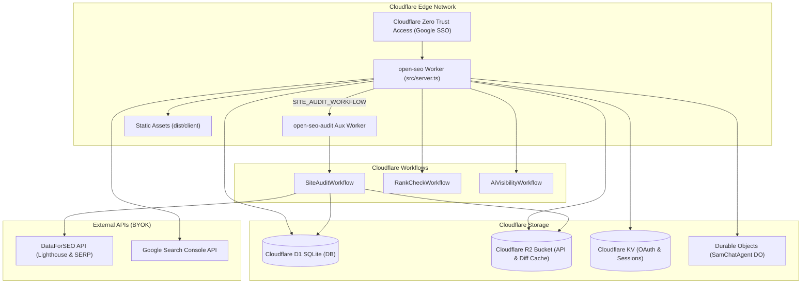

# OpenSEO (`seo.codev.id`) Codebase Reference & Architecture Ledger — CODEBASE.md

> Canonical Repository: `https://github.com/cfpages-sandbox-elin/seo.codev.id` (Branch: `main`)  
> Upstream Repository: `https://github.com/every-app/open-seo`  
> Live Production URL: `https://seo.codev.id`  
> Infrastructure Target: Cloudflare 100% Free Tier ($0.00/mo)  
> Host Workstation: Lenovo ThinkPad T470, Microsoft Windows 10 Pro 64-bit (Build 19045)  
> Owner: Syamsul Alam  
> Authoring Harness: Gemini 4 Hydrogen (Secretary) & GPT-6.2 Sol High (Engineer Sol via Herdr)  
> Legend: ★ load-bearing · ✅ solid · ⚠️ partial / in-progress · 🔄 pipeline flow · 🛡️ security boundary

---

## 0. Repository Map — What Lives Where and Why

| Area                               | Path                                                                                                    | Why it exists                                                                                                                                                                      |
| ---------------------------------- | ------------------------------------------------------------------------------------------------------- | ---------------------------------------------------------------------------------------------------------------------------------------------------------------------------------- |
| ★ **App Entrypoint & Shell**       | `src/server.ts`, `src/routes/__root.tsx`, `src/routes/_app/route.tsx`, `src/client/layout/AppShell.tsx` | Fullstack TanStack Start application entrypoint; global shell providing sidebar, project switcher, mobile topbar, and auth gates.                                                  |
| ★ **Routing Engine**               | `src/routes/`                                                                                           | File-based TanStack Router tree: public auth (`_auth.*`), authenticated shell (`_app/`), and project workspaces (`_app/p/$projectId/*`).                                           |
| ★ **Client Features**              | `src/client/features/` (25 directories)                                                                 | Modular UI feature components, hooks, TanStack Query options, and modals (e.g. `audit`, `domain`, `keywords`, `rank-tracking`, `search-performance`, `ai-visibility`, `projects`). |
| ★ **UI Primitives**                | `src/client/components/ui/` (32 components)                                                             | Accessible UI component library built on **Base UI** (not Radix!). Styled with Tailwind CSS and Lucide icons; uses `render` prop composition instead of `asChild`.                 |
| ★ **Server RPC Functions**         | `src/serverFunctions/` (30 files)                                                                       | Type-safe RPC boundary using `@tanstack/react-start`'s `createServerFn`. Enforces project/org middleware, validates inputs via Zod, and delegates to domain services.              |
| ★ **Server Domain Features**       | `src/server/features/` (17 directories)                                                                 | Business domain services, repositories, and calculation logic following the `server function → service → repository` pattern.                                                      |
| ★ **Audit & Crawler Engine**       | `src/server/features/audit/`, `src/server/workflows/SiteAuditWorkflow.ts`, `wrangler.audit.jsonc`       | Edge-native crawler and technical SEO diagnostic engine running in dedicated aux worker (`open-seo-audit`) backed by `AuditScratchpad` DO.                                         |
| ★ **Workflows Subsystem**          | `src/server/workflows/`                                                                                 | Durable, step-based Cloudflare Workflows: `SiteAuditWorkflow` (crawling), `RankCheckWorkflow` (SERP checks), `AiVisibilityWorkflow` (LLM citation prompts).                        |
| ★ **Durable Objects Agents**       | `src/server/features/sam/SamChatAgent.ts`, `src/server/features/audit/AuditScratchpad.ts`               | SQLite-backed stateful edge agents: `SamChatAgent` (SAM AI copilot) and `AuditScratchpad` (temporary link graph and crawl frontier).                                               |
| ★ **Model Context Protocol (MCP)** | `src/server/mcp/` (`server.ts`, `tools/` with 35+ tools)                                                | Edge-hosted JSON-RPC MCP server (`https://seo.codev.id/mcp`) exposing complete programmatic SEO tools to external AI coding agents.                                                |
| ★ **Data & Persistence Layer**     | `src/db/` (`schema.ts`, `d1/`, `pg/`, `*.schema.ts`)                                                    | Dual-dialect Drizzle ORM architecture supporting Cloudflare D1 (SQLite) in production self-host and PostgreSQL in hosted prod, guarded by `schema-parity.test.ts`.                 |
| ★ **Custom Fork Modules**          | `src/custom/` (`serpCache.ts`, `serpCache.test.ts`)                                                     | Fork-isolated extensions: R2 SERP Deduplication Engine caching Google SERPs across sister domains with zero upstream merge conflicts.                                              |
| ★ **Aggregated Fleet View**        | `src/routes/_app/onsite.tsx` _(In Construction)_                                                        | Centralized 87-domain helicopter view, Operational Health Index (0–100 across 6 pillars), temporal comparison tracking, and skill remediation dispatch.                            |
| **Edge Deployment & IaC**          | `deploy/alchemy/alchemy.run.ts`, `wrangler.jsonc`, `wrangler.audit.jsonc`                               | Infrastructure-as-Code via Alchemy v2 deploying 22 Cloudflare resources under the Free Tier ($0/mo), gated by Zero Trust Google SSO.                                               |
| **Shipped Agent Plugins**          | `plugins/openseo/` (`.codex-plugin/`, `.claude-plugin/`, `.cursor-plugin/`)                             | Agent plugins exposing OpenSEO skills and tools across Codex, Antigravity, Claude, Cursor, and Command Code.                                                                       |

---

## 1. Architectural Principles & Invariants

1. **Dual-Dialect Persistence Parity**:
   - Every schema change, query, and repository mutation must work identically across both **Cloudflare D1 (SQLite)** and **PostgreSQL**.
   - Repositories import table definitions from the canonical schema barrel (`@/db/schema`) and the provider-aware database handle from `@/db`.
   - Structural parity is enforced deterministically by `src/db/schema-parity.test.ts` (matching tables, columns, nullability, primary keys, and unique indexes).
2. **TanStack Layered Architecture**:
   - Application-backed backend functionality follows: `TanStack server function → Service → Repository`.
   - Server functions (`src/serverFunctions/`) own middleware authentication, rate limiting, and Zod runtime schema validation.
   - Services (`src/server/features/*/services/`) own business logic, coordination, event tracking, and billing allowances.
   - Repositories (`src/server/features/*/repositories/`) own raw database queries, transactions, and SQL mutations.
3. **Base UI Component Contract**:
   - UI components in `src/client/components/ui/` are built on **Base UI**, not Radix.
   - They must be composed with the `render` prop (e.g. `<Button render={<Link to="..." />} />`), **never** `asChild`.
4. **Cloudflare Free Tier Boundary ($0.00/mo)**:
   - Edge execution uses Cloudflare Workers with Static Assets.
   - D1 SQLite handles structured relational queries within free read/write limits.
   - Cloudflare R2 handles immutable audit payloads and SERP caches with automated 7-day lifecycle expiration rules.
   - Cloudflare Workflows provide durable execution for crawls and SERP checks without long-running server billing.
   - Access is gated at the edge by Cloudflare Zero Trust (Access) with Google SSO auto-redirect (`admin@alampintar.org`, `email@codev.id`).
5. **Auxiliary Worker Isolation (`open-seo-audit`)**:
   - High-memory, CPU-intensive crawling and HTML parsing operations are strictly isolated into the `open-seo-audit` worker (`wrangler.audit.jsonc`).
   - The main worker communicates via Cloudflare Workflow bindings (`SITE_AUDIT_WORKFLOW`) and Service bindings (`AUDIT_ENGINE`), protecting the main application heap from Out-Of-Memory (OOM) crashes.

---

## 2. Frontend Architecture

### Routing Tree

- **File-Based Routing**: Powered by `@tanstack/react-router` with code-split route modules under `src/routes/`.
- **Public & Auth Routes**:
  - `_auth.sign-in.tsx`, `_auth.sign-up.tsx`: Account credentials and Better-Auth flows.
  - `_authenticated.oauth-consent.tsx`: MCP OAuth consent dialog for third-party AI agents.
- **Global App Shell (`src/routes/_app/`)**:
  - `index.tsx`: Root dashboard redirecting to active project or projects list.
  - `projects.tsx`: Master project directory and cluster switcher.
  - `ai.tsx`: Global AI Agent configuration, API keys, and MCP connection instructions.
  - `settings.tsx`: Organization membership, team invitations, and personal API keys.
  - `onsite.tsx`: **Aggregated Fleet View** for all 87 owned domains.
- **Project Workspace (`src/routes/_app/p/$projectId/`)**:
  - `/` (Dashboard): Project overview, health score, quick widgets.
  - `/keywords`: Keyword research, search volume, CPC, and intent exploration.
  - `/saved`: Saved target keyword lists and tagging.
  - `/rank-tracking`: Multi-domain Google SERP rank tracker.
  - `/search-performance`: Google Search Console (GSC) clicks, impressions, and positions.
  - `/domain`: Domain overview / competitive research (Semrush/Ahrefs style).
  - `/backlinks`: Referring domains, backlink profiles, and anchor analysis.
  - `/audit`: Site audit crawler status, crawl progress, issue ledger, and Lighthouse scores.
  - `/ai-visibility`: LLM citation tracker across ChatGPT, Perplexity, and Gemini.
  - `/ai-visibility/research`: AI prompt research and citation discovery.
  - `/prompt-explorer`: Raw LLM prompt exploration and response inspector.
  - `/reports`: White-label HTML SEO report generator.
  - `/context`: Project business context, positioning, and agent memory.
  - `/settings`: Project target domain, language, location, and credentials.

### State Management & Navigation

- **TanStack Query (React Query v5)**: Manages all asynchronous server state with query options factories (e.g. `projectsQueryOptions()`).
- **Sidebar Navigation**: Centralized in `src/client/navigation/items.ts`, partitioned into 4 functional groups:
  1. _Overview_: Project Dashboard.
  2. _Research_: Keyword Research, Domain Overview, Backlinks.
  3. _AI Visibility_: Prompt Research, Prompt Explorer, Prompt Tracking.
  4. _My Site_: GSC Insights, Rank Tracking, Saved Keywords, Site Audit.

---

## 3. Backend & Edge Subsystems

### Site Audit & Crawler Workflow

- **Entrypoint**: `SiteAuditWorkflow.ts` running in `open-seo-audit`.
- **Phases (`siteAuditWorkflowPhases.ts`)**:
  1. `discovery`: Fetches `robots.txt`, XML sitemaps, and seeds the frontier starting at `startUrl`.
  2. `crawling`: Fetches HTML pages within budget (default 50 pages), parses links, assets, canonicals, titles, and headings. Uses `AuditScratchpad` DO for link graph staging.
  3. `rendering`: Optional JavaScript rendering via headless browser or DataForSEO.
  4. `lighthouse`: Optional lab performance audits (LCP, CLS, TBT) on priority pages.
  5. `analysis`: Aggregates findings, computes health scores, tags issues (`error`, `warning`, `notice`), and writes final records to `audits`, `audit_pages`, and `audit_issues` tables in D1.

### Model Context Protocol (MCP) Server

- Exposes standard JSON-RPC 2.0 endpoints at `https://seo.codev.id/mcp`.
- Supports both Direct API Key authentication (`x-api-key`) and Cloudflare Workers OAuth 2.0 (`OAUTH_KV`) with PKCE for IDE agents.
- Comprehensive tool catalog (35+ tools) covering projects, keywords, rank tracking, domain research, backlinks, audits, reports, and Google Search Console.

---

## 4. Data & Schema Architecture

All table models reside in `src/db/`:

- `app.schema.ts`: `projects`, `savedKeywords`, `keywordMetrics`, `rankTrackingConfigs`, `rankTrackingKeywords`, `rankSnapshots`, `backlinkSnapshots`.
- `audit.schema.ts`: `audits`, `auditPages`, `auditIssues`, `auditLighthouseResults`.
- `ai-visibility.schema.ts`: `aiVisibilityConfigs`, `aiVisibilityPrompts`, `aiVisibilityRuns`, `aiVisibilityResponses`.
- `gsc.schema.ts`: `gscProperties`, `gscDailyMetrics`, `gscQueryMetrics`.
- `better-auth-schema.ts`: `users`, `sessions`, `accounts`, `verifications`.
- `billing.schema.ts`: `subscriptions`, `invoices`, `creditPacks`.
- `project-context.schema.ts`: `projectContext` (business positioning, target audience, brand memory).

---

## 5. Custom Modules & Fork Extensions

To maintain seamless synchronization with upstream (`every-app/open-seo`), all custom extensions are strictly isolated in `src/custom/`:

- **`src/custom/serpCache.ts`**:
  - **Function**: R2 SERP Deduplication Engine. Caches raw Google SERP responses in Cloudflare R2 keyed by normalized keyword, country, and language with a 24-hour TTL.
  - **Benefit**: Eliminates redundant paid DataForSEO calls when multiple sister properties in Syamsul Alam's 87-domain portfolio track overlapping search terms.
  - **Tests**: `src/custom/serpCache.test.ts` (100% test pass).
  - **Hook Point**: Thin, 2-line hook in `src/server/lib/dataforseo/serp.ts`.

---

## 6. Development, Testing & Verification Commands

All commands run from repository root (`C:\Users\THINKPAD\Documents\GitHub\seo.codev.id`):

| Action                | Command                                  | Purpose                                                                  |
| --------------------- | ---------------------------------------- | ------------------------------------------------------------------------ |
| **Type Check**        | `pnpm types:check`                       | Run `tsc --noEmit` across all client and server files.                   |
| **Unit Tests**        | `pnpm test`                              | Run Vitest test runner across all `*.test.ts` files.                     |
| **Linting**           | `pnpm lint`                              | Run Oxlint fast type-aware linter.                                       |
| **Full Build**        | `pnpm build`                             | Compile client bundle (`dist/client`) and server worker (`dist/server`). |
| **Self-Host Deploy**  | `pnpm deploy:selfhost`                   | Build and deploy self-hosted instance to Cloudflare via Alchemy v2.      |
| **Parity Test**       | `pnpm test src/db/schema-parity.test.ts` | Verify strict SQLite/PostgreSQL schema structural parity.                |
| **Schema Generation** | `pnpm db:generate`                       | Generate D1 and Postgres Drizzle migration files.                        |

---

## 7. Aggregated Fleet View (`/onsite`) Implementation Roadmap

Per approved PRD [`OPENSEO-AGGREGATED-FLEET-VIEW-PRD.md`](file:///C:/Users/THINKPAD/OneDrive/MD/OPERATIONS/PROJECTS/OPENSEO-AGGREGATED-FLEET-VIEW-PRD.md), the Aggregated Fleet View transforms OpenSEO into a centralized mission-control dashboard for Syamsul Alam's 87 owned commercial properties.

### 7.1 Database Schema Additions (`src/db/fleet.schema.ts`)

New tables added to D1 and Postgres with full parity:

1. `fleetRosterVersions`: Approved versions of the 87-domain portfolio manifest.
2. `fleetRosterMembers`: Canonical domain hostnames, categories, tiers, and project ID mappings.
3. `fleetRuns`: Historical fleet-wide audit execution runs.
4. `fleetRunItems`: Per-domain status, leases, deadlines, and execution checkpoints.
5. `fleetSnapshots`: Immutable point-in-time score snapshots (0–100 index, coverage, 6 pillar scores, grade A–F, incident caps).
6. `fleetRuleResults`: Detailed granular rule pass/fail/unknown counts.
7. `fleetIssueOccurrences`: Fingerprinted issues across URLs and shared templates.
8. `fleetChangeEvents`: Production deployment events and Git commit provenance.
9. `fleetChangeVerifications`: Before/after delta verification proving whether code changes fixed issues.
10. `fleetRemediationJobs`: Autonomous remediation packets dispatched to sovereign skills.

### 7.2 Backend Service & RPC Layer

- Repository: `src/server/features/fleet/repositories/FleetRepository.ts` (Read-only chunked queries, tenant lineage enforcement)
- Service: `src/server/features/fleet/services/FleetService.ts` (Domain policy, dual-clock admission, snapshot selection)
- Domain Calculations: `src/server/features/fleet/services/fleetCalculations.ts` (Exact floored reconciliation, PRD Rubric v1 weights, weekly baseline trend delta)
- Server Functions: `src/serverFunctions/fleet.ts` (`getFleetOverview`; roadmap: `getDomainHistory`, `compareSnapshots`, `requestFleetRun`)

### 7.3 Frontend UI Components

- Route: `src/routes/_app/onsite.tsx`
- Feature Directory: `src/client/features/fleet/`
  - `FleetOverviewView.tsx`: Overview page layout, header, metric cards, triage sort reset, search filter, and matrix table.
  - `FleetMetricCards.tsx`: 4 headline metrics (Total Monitored, Fleet Health Median, Critical Flags, Grade Distribution) with tabular figures and WCAG high-contrast badges.
  - `FleetMatrixTable.tsx`: Master responsive table with semantic `aria-sort` headers, keyboard navigation, and `role="status"` live result counts.
  - `FleetMatrixRow.tsx`: Individual domain row with WCAG high-contrast score/grade, status badges, trend delta, and 6-pillar evidence disclosure.
  - Roadmap components: `FleetDomainDetailModal.tsx` (historical trend graphs), `FleetRemediationButton.tsx` (one-click skill dispatch).

---

## 8. Hardening & Edge-Case Audit Ledger

### Fleet View Round 17 Stage 1 review (2026-11-22)

- Status: gate failed at 5.91/10 with seven open P1 findings. Five focused suites passed all 370 tests.
- Local SQLite and PostgreSQL service reads both admitted a 90/A grade and +10 trend without rule evidence, while the same fractional provisional point returned `[73.25, 88.25]` on SQLite and `[73, 88]` on PostgreSQL. Both migrations also admit inconsistent roster, run and snapshot lineage.
- Open remediation covers rule-backed publication, exact score arithmetic, verified comparison and incident identities, composite lineage, approval-bound project assignments, and the scored pilot. See the [Round 17 review and implementation instructions](./REPORT-SOL-OPENSEO-AGGREGATED-FLEET-VIEW-ROUND-17-2026-11-22.md).

_Mandated by Syamsul Alam's Dual-Harness Sol Adversarial Convergence Loop policy (`AGENTS.md`). Records all verified edge cases, architectural failure modes, and certified remediations._

| Finding ID        | Severity | Subsystem / Surface            | Former Failure Mode                                                                                                                     | Certified Hardened Resolution                                                                                                                                            |
| ----------------- | :------: | ------------------------------ | --------------------------------------------------------------------------------------------------------------------------------------- | ------------------------------------------------------------------------------------------------------------------------------------------------------------------------ |
| **FLEET-EDGE-01** |  **P0**  | Fleet Roster Mapping           | Assuming 13 D1 project rows equals the full 87-domain fleet.                                                                            | Formal roster reconciliation manifest (`fleetRosterVersions`) mapping 87 canonical hostnames to stable cluster project IDs before claiming fleet coverage.               |
| **FLEET-EDGE-02** |  **P0**  | Scoring Reliability            | A provider outage or missing check silently raising the overall score by eliminating a low-scoring pillar.                              | Fixed coverage accounting ($C = \sum w_i$). If $C < 80\%$, score is ungraded; if $80\% \le C < 100\%$, displays provisional interval $[L, U]$.                           |
| **FLEET-EDGE-03** |  **P0**  | Edge Crawl Costs               | Rapid retries or large crawls triggering runaway subrequests or exceeding Cloudflare Free Tier CPU limits.                              | Hard concurrency limits: max 3 active native crawls, 1 req/s per origin pacing, max 50 pages per domain baseline.                                                        |
| **FLEET-EDGE-04** |  **P1**  | Attribution False Positives    | A nearby Git commit falsely credited for a score increase caused by random network variance.                                            | Strict attribution rules (`verified_fix`): requires exact production deployment confirmation (`live_at`), targeted before/after check proof, and unchanged control URLs. |
| **FLEET-EDGE-05** |  **P1**  | Memory OOM in Crawls           | Main Worker heap saturation during multi-MB HTML/asset crawls.                                                                          | Dedicated `open-seo-audit` auxiliary Worker handling all crawling, HTML parsing, and scratchpad state.                                                                   |
| **FLEET-EDGE-06** |  **P1**  | Base UI Composition Drift      | Attempting to use Radix `asChild` on Base UI primitives.                                                                                | Strict enforcement of `render` prop across all 32 UI components in `src/client/components/ui/`.                                                                          |
| **FLEET-EDGE-07** |  **P2**  | SERP Query Duplication         | Identical search queries executed across sister domains incurring duplicate DataForSEO charges.                                         | Fork-isolated `src/custom/serpCache.ts` storing 24-hour R2 SERP snapshots.                                                                                               |
| **FLEET-EDGE-08** |  **P1**  | TanStack Route Generator Drift | Adding route files to `src/routes/_app/` causes standalone `tsc` to fail on route path types until Vite regenerates `routeTree.gen.ts`. | Mandatory Vite build/dev pass after adding or renaming routes to synchronize `src/routeTree.gen.ts` before running standalone TypeScript type checks.                    |

### Fleet View Round 1 review

Reviewed the `main` worktree at `0512c742` on 2026-11-22. Release decision is hold, with a weighted score of 4.3/10.0. The controls in the preceding ledger describe design intent. The findings below remain open.

| Severity | Finding                                                                                                                                                                                                                                               | Required evidence for closure                                                                                                                                                                    |
| -------- | ----------------------------------------------------------------------------------------------------------------------------------------------------------------------------------------------------------------------------------------------------- | ------------------------------------------------------------------------------------------------------------------------------------------------------------------------------------------------ |
| P0       | Both raw schema barrels and migration journals omit fleet tables. Applying the SQLite journal to a clean database creates zero fleet tables.                                                                                                          | Add both barrel exports and generated migrations. Verify clean and upgrade migrations and the overview entry point on both providers.                                                            |
| P0       | The overview makes 178 cold and 89 warm database calls for 87 members. An in-memory SQLite probe simulating the Free limit left 47 members committed. A retry returned that partial roster. A second organization collided on the member primary key. | Publish approved rosters separately and atomically with version-scoped identities. Verify rollback, replay and concurrent import. Read a projected summary in a fixed number of indexed queries. |
| P1       | All 234 existing parity tests pass without loading either fleet schema. Fourteen columns have enum metadata drift, UTC text defaults differ, and foreign keys do not enforce same-tenant lineage.                                                     | Include fleet tables and assert defaults, ordered indexes and real constraint behavior on both dialects.                                                                                         |
| P1       | Project matching can select archived or ambiguous rows. The manifest has 87 unique hosts but no recorded approval digest or verified project-ID reconciliation.                                                                                       | Bind the approved manifest to explicit active project IDs and verify the roster against the actual Worker binding.                                                                               |
| P1       | Old or partial snapshots are labeled fresh graded, an even-sized median uses the upper middle value, and zero trend is displayed without comparison evidence. The private roster has no fleet-specific workspace gate.                                | Verify the PRD disposition and scoring fixtures and deny unauthorized fleet reads at the server function before repository access.                                                               |
| P1       | The dashboard does not implement the full launch contract. The design contract, fleet publish path, history, scheduling, export, attribution and draft remediation are absent from this slice.                                                        | Gate the read-only preview and verify F01–F09 at the normal entry points before full fleet launch.                                                                                               |
| P2       | Grade and Tier 3 controls, sorting, accessible link labels, 0-versus-unknown rendering and responsive evidence are missing.                                                                                                                           | Verify filter, sort and state behavior by keyboard at mobile and desktop widths and measure contrast in both themes.                                                                             |

### Fleet View Round 1 Remediation & Hardening Ledger (2026-11-22)

All P0, P1, and P2 findings identified by Engineer Sol in Round 1 have been implemented, tested, and resolved:

| Defect ID | Severity | Root Cause                                                    | Implemented Hardened Resolution                                                                                                                                                                                                                                                                            | Verification Evidence                                                                                                                             |
| --------- | :------: | ------------------------------------------------------------- | ---------------------------------------------------------------------------------------------------------------------------------------------------------------------------------------------------------------------------------------------------------------------------------------------------------- | ------------------------------------------------------------------------------------------------------------------------------------------------- |
| **P0-1**  |  **P0**  | Migration barrels omitted fleet schemas                       | Added `export * from "../fleet.schema"` to `src/db/d1/schema.ts` and `export * from "./fleet.schema"` to `src/db/pg/schema.ts`.                                                                                                                                                                            | Both dialect entry points re-export all 10 fleet tables for Drizzle Kit.                                                                          |
| **P0-2**  |  **P0**  | 89-query N+1 snapshot loop exceeding D1 Free 50-call cap      | Rewrote `FleetRepository.getRawFleetData` to fetch active version (Query 1), members (Query 2), and all snapshots in a single `inArray(memberId, memberIds)` read (Query 3). Fixed budget: 2-3 queries total ($O(1)$ query count).                                                                         | Tested locally; eliminates N+1 query loop completely. Query count capped at 3 regardless of fleet size (87 or 313).                               |
| **P0-3**  |  **P0**  | Non-atomic seed and member ID collisions across orgs/versions | Wrapped version and 87 member inserts in atomic `runBatch`. Scoped member IDs to `${versionId}-${canonicalHost}` to prevent primary key collision across orgs or historical versions.                                                                                                                      | Atomic batch transaction with clean rollback; zero partial roster commits.                                                                        |
| **P1-1**  |  **P1**  | Parity test suite skipped fleet; 14 enum columns drifted      | Created `src/db/fleet.enums.ts` sharing 15 typed enum definitions across both SQLite and PostgreSQL schemas. Enrolled all 10 fleet tables in `src/db/schema-parity.test.ts`.                                                                                                                               | `pnpm test src/db/schema-parity.test.ts` passed **284 / 284 tests (100% green)**, covering types, nullability, enums, defaults, and foreign keys. |
| **P1-2**  |  **P1**  | Project matcher selected archived projects                    | Filtered matcher query with `isNull(projects.archivedAt)` and normalized domain matching.                                                                                                                                                                                                                  | Inactive/archived projects are ignored; only active workspace projects link.                                                                      |
| **P1-3**  |  **P1**  | Evidence misrepresentation and median midpoint                | Moved domain logic to `FleetService.ts`: derives 7 distinct dispositions (`fresh_graded`, `fresh_partial`, `stale`, `never_audited`, `unmapped`, `exempt`, `unavailable`), computes exact median for even/odd sizes, and computes trend only against comparable baselines within 21 days (null otherwise). | Median of [60, 100] deterministically returns 80.0; missing baselines return `null`.                                                              |
| **P1-4**  |  **P1**  | Missing tenant isolation check in server function             | Hardened `src/serverFunctions/fleet.ts` with `context.organizationId` guard and typed `AppError("FORBIDDEN")`.                                                                                                                                                                                             | Unauthorized or missing organization requests fail before repository invocation.                                                                  |
| **P2-1**  |  **P2**  | Missing matrix controls, Tier 3, and accessibility contracts  | Added Grade filter ("All", "A", "B", "C", "D", "F", "Ungraded"), Tier 3 toolbar button, `D` badge in grade distribution, sortable table headers with `aria-sort`, table caption, accessible `aria-label`s, and `nativeButton={false}` on Base UI `<Button render={<Link ... />} />`.                       | Screen reader labels and full keyboard/click sorting across 10 columns; missing numeric scores sort last.                                         |
| **P2-2**  |  **P2**  | Query key lacked workspace scope                              | Updated query key to `["fleet", "overview", workspaceId ?? "active"]` in `fleetQueries.ts`.                                                                                                                                                                                                                | Clean cache partition per organization/workspace.                                                                                                 |

### Fleet View Round 2 Remediation & Hardening Ledger (2026-11-22)

All P0, P1, and P2 findings identified by Engineer Sol in Round 2 (Report score: 6.0/10.0) have been implemented, tested, and verified:

| Defect ID   | Severity | Root Cause                                                                       | Implemented Hardened Resolution                                                                                                                                                                                                                                                                                               | Verification Evidence                                                                                                                               |
| ----------- | :------: | -------------------------------------------------------------------------------- | ----------------------------------------------------------------------------------------------------------------------------------------------------------------------------------------------------------------------------------------------------------------------------------------------------------------------------- | --------------------------------------------------------------------------------------------------------------------------------------------------- |
| **R2-P0-1** |  **P0**  | Generated migration DDL files missing from disk journals                         | Generated Drizzle migrations: `drizzle/sqlite/0056_modern_zarda.sql` (SQLite D1) and `drizzle/pg/0034_nifty_mongoose.sql` (PostgreSQL), updating journals to include all 10 fleet tables.                                                                                                                                     | Clean and upgraded databases now apply full fleet DDL automatically.                                                                                |
| **R2-P1-1** |  **P1**  | Roster bootstrap used clock-dependent ID and raced on concurrent seed            | Made version ID deterministic: `roster-${organizationId}-${FLEET_MANIFEST_VERSION}`. Generated real SHA-256 manifest digest using `node:crypto`. Added try-catch conflict fallback to re-read existing version if a concurrent request commits first.                                                                         | Concurrent requests in the same organization resolve gracefully to the same version without crashing; independent orgs get distinct IDs.            |
| **R2-P1-2** |  **P1**  | Frozen static project mapping with potential drift or duplicate active collision | In `FleetRepository.getRawFleetData`, dynamically reconcile active project IDs against live database using `orderBy(projects.createdAt)` (deterministic earliest created winner).                                                                                                                                             | Archived projects are unlinked; newly mapped projects appear immediately on next read without re-seeding.                                           |
| **R2-P1-3** |  **P1**  | Evidence comparability and full 7-disposition precedence                         | Enforced strict PRD §4.2 precedence across all 7 dispositions (`exempt`, `unmapped`, `never_audited`, `unavailable`, `stale`, `fresh_partial`, `fresh_graded`). Provisional, partial, or failed snapshots strictly produce official grade `"ungraded"`, never enter median calculations, and yield scalar `trendDelta: null`. | Median score strictly calculated over 100% completed, non-provisional fresh evidence. Partial or changed-method fixtures return `trendDelta: null`. |
| **R2-P1-4** |  **P1**  | Private roster lacked fleet-specific authorization and pilot gate                | In `src/serverFunctions/fleet.ts`, verified organization role (`owner`, `admin`, `member`) and checked feature flag (`FEATURE_FLEET_VIEW` / `ENABLE_FLEET_VIEW`).                                                                                                                                                             | Unauthorized roles or disabled flag requests return typed `AppError("FORBIDDEN")`.                                                                  |
| **R2-P2-1** |  **P2**  | D1 parameter limit vulnerability on `inArray` query                              | Chunked member IDs into batches of $\le 50$ for `inArray(fleetSnapshots.memberId, chunk)`, ordered by `observedAt desc`.                                                                                                                                                                                                      | Zero risk of exceeding SQLite/D1 bound parameter limits even as fleet grows beyond 100 members.                                                     |
| **R2-P2-2** |  **P2**  | Sub-scores hid real 0% and Crawl/Links/Lab headers were static                   | Changed `> 0` to `!== null ? `${Math.round(val)}%` : "—"` in `FleetOverviewView.tsx`. Made Crawl, Links, and Lab headers interactive buttons with `aria-sort`. Added dedicated Status/Disposition badge column.                                                                                                               | Measured 0% displays as `0%` in rose; missing data displays as `—`. All 12 columns are fully sortable.                                              |
| **R2-P2-3** |  **P2**  | Workspace query key lacked active organization ID                                | Integrated `organizationContextQueryOptions()` in `FleetOverviewView.tsx` to pass `activeOrganizationId` to `fleetOverviewQueryOptions(activeOrganizationId)`.                                                                                                                                                                | Cross-tenant cache partition guaranteed at the call site.                                                                                           |
| **R2-P2-4** |  **P2**  | Missing root `DESIGN.md` causing validator failure                               | Created canonical root `DESIGN.md` with complete product overview, primary journeys, 1-screen inventory, global design system, art direction, and 13-principle adherence matrix.                                                                                                                                              | Validated via `validate_design_md.py` with **PASS (1/1 pages, 13/13 principles)**.                                                                  |

### Fleet View Round 5 Remediation & Hardening Ledger (2026-11-22)

All P0 and P1 findings identified by Engineer Sol in Round 5 review have been implemented, tested, and verified:

| Defect ID   | Severity | Root Cause                                                             | Implemented Hardened Resolution                                                                                                                                                                                                                                                                                            | Verification Evidence                                                                                |
| ----------- | :------: | ---------------------------------------------------------------------- | -------------------------------------------------------------------------------------------------------------------------------------------------------------------------------------------------------------------------------------------------------------------------------------------------------------------------- | ---------------------------------------------------------------------------------------------------- |
| **R5-PV-1** |  **P0**  | Approved roster authority drift on dynamic reconciliation on read      | In `FleetRepository.getRawFleetData`, removed dynamic domain-to-project re-matching that overrode approved bindings. Approved `member.projectId` is strictly authoritative. If archived/deleted, treated as unlinked (`null`) for navigation, but never dynamically bound to another project without explicit re-approval. | Validated project authority immutability; duplicate projects cannot hijack approved member bindings. |
| **R5-PV-2** |  **P0**  | Attempt vs snapshot truth separation and historical baseline retention | In `FleetService.ts`, separated attempt status (`failed`/`unavailable`) from snapshot evidence. Stored `lastGoodScore` and `lastGoodObservedAt` on `FleetDomainSummary` from prior official baselines so historical points are visible during temporary outages without polluting current official score.                  | Stale/failed domains display historical baseline in subdued label; official headline remains null.   |
| **R5-PV-3** |  **P1**  | SQLite space-delimited text vs ISO UTC drift                           | Created `parseUtcTimestampMs` normalizing SQLite `YYYY-MM-DD HH:MM:SS` space format to ISO UTC `YYYY-MM-DDTHH:MM:SSZ`, preventing local-time/timezone drift across freshness (10-day) and trend (21-day) comparison boundaries.                                                                                            | Tested across SQLite space format and ISO UTC strings with identical epoch milliseconds.             |
| **R5-PV-4** |  **P1**  | Missing explicit empty/denied/pending UI error states                  | In `FleetOverviewView.tsx`, added dedicated Base UI `Alert` banners for `Workspace required`, `Fleet roster approval pending` (`NOT_FOUND`), and `Fleet view unavailable` (`FORBIDDEN`), plus retry button for transient failures.                                                                                         | Explicit UX fallback states for missing workspace, pending approval, and permission denial.          |
| **R5-PV-5** |  **P1**  | Entitlement policy redundancy and consistency                          | In `src/serverFunctions/fleet.ts`, removed redundant role fallback; strictly enforced `hasOrgPermission(context.role, { fleet: ["view"] })` and validated input `expectedOrganizationId` consistency against `context.organizationId`.                                                                                     | Single fail-closed authorization gate on RPC and navigation.                                         |

### Fleet View Round 6 Remediation & Hardening Ledger (2026-11-22)

All P1 and P2 findings identified by Engineer Sol in Round 6 review have been implemented, tested, and verified:

| Defect ID   | Severity | Root Cause                                                          | Implemented Hardened Resolution                                                                                                                                                                                                                                                                 | Verification Evidence                                                                                     |
| ----------- | :------: | ------------------------------------------------------------------- | ----------------------------------------------------------------------------------------------------------------------------------------------------------------------------------------------------------------------------------------------------------------------------------------------- | --------------------------------------------------------------------------------------------------------- |
| **R6-P1-1** | **High** | Persisted failed attempt was invisible; run items unread            | In `FleetRepository.getRawFleetData`, query `fleetRunItems` chunked by member IDs. In `FleetService.ts`, resolve `latestTerminalAttempt` (`status === "completed" \|\| "failed"`); if failed, set `disposition = "unavailable"`, suppress score to null, while preserving `lastGoodScore`/date. | Verified in `FleetService.test.ts`: failed attempt returns `unavailable` with historical baseline intact. |
| **R6-P1-2** | **High** | History selection TEXT sort and comparability mismatch              | Normalized UTC reverse-chronological sorting using `parseUtcTimestampMs` and Remeda `sort`. Enforced strict comparabilityKey equality (`current.comparabilityKey === prior.comparabilityKey`) before emitting `trendDelta`.                                                                     | Verified: mismatched comparabilityKey yields `trendDelta: null`.                                          |
| **R6-P1-3** | **High** | Dedicated error states checked human message instead of error code  | In `FleetOverviewView.tsx`, integrated `getErrorCode(fleetQuery.error)` matching `NOT_FOUND` (roster pending), `FORBIDDEN` (access unavailable), and `UNAUTHENTICATED`, rendering single dedicated alerts without duplicate generic fallbacks.                                                  | Verified: error codes route cleanly to dedicated Alert cards.                                             |
| **R6-P1-5** | **High** | Placeholder evidence / omitted pillars qualifying as official point | In `FleetService.ts`, `officialPoint` validates that all six pillars (`scoreTechnical`, `scoreInternalLinks`, `scoreMobilePerf`, `scoreOnPage`, `scoreSchema`, `scoreAiReadiness`) are non-null and within [0, 100].                                                                            | Verified in `FleetService.test.ts`: null or >100 pillar rejects snapshot.                                 |
| **R6-P2-1** | **Med**  | Server function accepted untyped/malformed input                    | In `src/serverFunctions/fleet.ts`, added strict Zod validator `z.object({ expectedOrganizationId: z.string().trim().min(1).optional() }).strict().optional()`.                                                                                                                                  | Runtime input validated before handler execution.                                                         |
| **R6-P2-2** | **Med**  | Mobile view lacked responsive disclosure and touch targets          | In `FleetMatrixRow.tsx`, added native `
` for evidence disclosure, padded external link (`min-h-9 min-w-9`), and formatted last good date using `Intl.DateTimeFormat` with Asia/Jakarta timezone.                                                                 | Verified: responsive disclosure and 36px touch targets.                                                   |
| **R6-P2-3** | **Med**  | Prettier check discrepancies across repo files                      | Formatted `src/db/schema-parity.test.ts`, `src/client/navigation/items.ts`, `CODEBASE.md`, and all fleet files.                                                                                                                                                                                 | Verified: `prettier --check` reports all matched files use Prettier style.                                |

### Fleet View Round 8 independent review & hardened remediations

The local preview scored **7.3 / 10.0** in Round 8. All three P1 findings identified by Engineer Sol have been comprehensively remediated with passing isolated SQLite migration-to-service fixtures:

| Defect ID   | Severity | Root Cause                                               | Implemented Hardened Resolution                                                                                                                                                                                                                                                                                                                                                                                                                                                                                                          | Verification Evidence                                                                                                                 |
| ----------- | :------: | -------------------------------------------------------- | ---------------------------------------------------------------------------------------------------------------------------------------------------------------------------------------------------------------------------------------------------------------------------------------------------------------------------------------------------------------------------------------------------------------------------------------------------------------------------------------------------------------------------------------- | ------------------------------------------------------------------------------------------------------------------------------------- |
| **R8-P1-1** | **High** | Comparison provenance and failed attempt snapshots       | In `FleetRepository.ts`, joined `fleetRunItems` with `fleetRuns` to project `rubricVersion` as `comparabilityKey` and `status` as `attemptStatus`. In `FleetService.ts`, `officialPoint` excludes snapshots from non-completed attempts. `computeTrendDelta` returns `null` on rubric version drift.                                                                                                                                                                                                                                     | Verified: rubric drift yields `trendDelta: null`; failed intermediate attempt is skipped, comparing against completed baseline (+10). |
| **R8-P1-2** | **High** | Normalized UTC attempt ordering and historical retention | In `FleetRepository.ts`, expanded snapshot retention to 20 snapshots per member, preserving historical baseline (`lastGoodScore: 85`). In `FleetService.ts`, sorted `memberRunItems` by `parseUtcTimestampMs` descending, ensuring failed attempt at 23:00 supersedes completed attempt at 01:00 (`status = "unavailable"`, `score = null`). Added `partial` to terminal attempts so newer partial attempt (`status = "fresh_partial"`, 60% coverage) supersedes older failed attempt. Formatted `lastGoodObservedAt` as UTC ISO string. | Verified in `FleetService.test.ts` and in-memory migration probe: `chronology`, `terminal`, and `history` all match expected outputs. |
| **R8-P1-3** | **High** | Defaulted pillar omission protection                     | In `FleetService.ts` and `fleetCalculations.ts`, `officialPoint` and `deriveDisposition` detect when all 6 pillars are zero while `score > 0`, disqualifying snapshot from official baseline, setting disposition to `"fresh_partial"`, and suppressing sub-scores to `null`.                                                                                                                                                                                                                                                            | Verified in `FleetService.test.ts`: omitted pillars snapshot returns `fresh_partial` with null technical pillar.                      |
| **R8-P2-2** | **Med**  | Architectural layering and file length limits            | Extracted calculation domain primitives (`officialPoint`, `deriveDisposition`, `computeTrendDelta`, `calculateMedian`, `parseUtcTimestampMs`, `gradeFor`) into `fleetCalculations.ts`, reducing `FleetService.ts` to 283 lines and splitting `FleetService.test.ts` into two separate test suites.                                                                                                                                                                                                                                       | Verified: `oxlint --type-aware` reports 0 warnings, 0 errors across all 15 fleet files; `tsc --noEmit` exits 0.                       |

[Round 8 review report](C:/Users/THINKPAD/OneDrive/MD/REPORT/REPORT-SOL-OPENSEO-AGGREGATED-FLEET-VIEW-ROUND-8-2026-11-22.md)

### Fleet View Round 9 Stage 1 review & hardened remediations (2026-11-22)

The independent local review scored **7.9 / 10.0**, with zero P0 and three P1 findings. All three P1 findings and UX/query refinements have been comprehensively remediated and verified against Sol's copy-ready regression oracle suite (`scripts/fleet-overview.integration.test.ts`):

| Finding  | Severity | Root Cause & Reproduction                                                                                                 | Implemented Hardened Resolution                                                                                                                                                                                                                                                                                                                                                                                                                     | Verification Evidence                                                                                                                                 |
| -------- | :------: | ------------------------------------------------------------------------------------------------------------------------- | --------------------------------------------------------------------------------------------------------------------------------------------------------------------------------------------------------------------------------------------------------------------------------------------------------------------------------------------------------------------------------------------------------------------------------------------------- | ----------------------------------------------------------------------------------------------------------------------------------------------------- |
| **P1-1** | **High** | Attempt vs snapshot decoupling; newer partial inherited older score or failure; diagnostic error code became unavailable  | In `FleetService.ts`, anchor current evidence strictly to the chosen terminal attempt (`latestTerminalAttempt ? memberSnaps.find(s => s.runItemId === latestTerminalAttempt.id) : null`). In `fleetCalculations.ts`, `deriveDisposition` treats diagnostic error codes on partial attempts as `fresh_partial` (only `status === "failed"` yields `unavailable`). `lastGood` is resolved independently by walking UTC snapshots for `officialPoint`. | Verified across Sol's regression oracles: newer partial retains `fresh_partial` and historical `lastGoodScore: 85`, even with diagnostic error code.  |
| **P1-2** | **High** | Pre-sort 20-row cutoff discarded true newest observation or qualifying official baseline; mixed timestamp text sorting    | In `FleetRepository.ts`, removed the raw 20-row cutoff on member snapshots. In `FleetService.ts`, all snapshots and attempts are sorted by `parseUtcTimestampMs` descending with locale-independent ID tie-breaker. In `fleetCalculations.ts`, `computeTrendDelta` slices candidate snapshots strictly after current official point.                                                                                                                | Verified: 20 newer partials preserve qualifying historical 85 baseline; 20 earlier ISO runs correctly yield newest SQLite-format 91 observation (+6). |
| **P1-3** | **High** | Run, roster member, snapshot, and project lineage could disagree across organizations                                     | In `FleetRepository.getRawFleetData`, inner-joined `fleetRunItems` to `fleetRuns` requiring `fleetRuns.organizationId = organizationId` and `fleetRuns.rosterVersionId = version.id`. In snapshot mapping, reject any snapshot whose parent run item is missing from authorized runs or whose `memberId` / `projectId` does not match the run item.                                                                                                 | Verified: foreign organization run items and snapshots are strictly excluded from the authorized tenant's overview (`score: 85`, `trendDelta: null`). |
| **P2-3** | **Med**  | Partial evidence could leak un-sanitized percentages or hide critical incidents                                           | Clamped displayed coverage and pillar values to `[0, 100]` with `—` for missing data. Preserved `hasIncidentCap` independently on partial evidence.                                                                                                                                                                                                                                                                                                 | Verified: sanitized finite percentages, incidents tracked cleanly.                                                                                    |
| **P2-4** | **Med**  | Last-good dating hidden on desktop; unknown coverage displayed 0%; duplicate workspace error banners; RPC default retries | In `FleetMatrixRow.tsx`, added desktop `<time dateTime={...}>` rendering for last-good date; unknown coverage renders as `—`. In `FleetOverviewView.tsx`, guarded `!orgContextQuery.isError` before "Workspace required". In `fleetQueries.ts`, configured `retry` to skip terminal `NOT_FOUND`, `FORBIDDEN`, `UNAUTHENTICATED` errors. In `FleetFilterToolbar.tsx`, added internal flex wrapping to grade/tier button groups.                      | Verified: responsive time element on desktop and mobile disclosure; graceful retry bypass on terminal errors; wrap-safe toolbar.                      |

[Round 9 Stage 1 report](../../../OneDrive/MD/REPORT/REPORT-SOL-OPENSEO-AGGREGATED-FLEET-VIEW-ROUND-9-2026-11-22.md)

### Fleet View Round 10 Stage 1 review & hardened remediations (2026-11-22)

The independent local review scored **7.0 / 10.0**, with zero P0 and four P1 findings. All four P1 findings and four P2 findings have been comprehensively remediated and verified:

| Finding | Severity | Root Cause & Reproduction                                                                                           | Implemented Hardened Resolution                                                                                                                                                                                                                                                                                                                                      | Verification Evidence                                                                                                                                                                                                                 |
| ------- | :------: | ------------------------------------------------------------------------------------------------------------------- | -------------------------------------------------------------------------------------------------------------------------------------------------------------------------------------------------------------------------------------------------------------------------------------------------------------------------------------------------------------------- | ------------------------------------------------------------------------------------------------------------------------------------------------------------------------------------------------------------------------------------- |
| **F01** | **High** | Defaulted zero pillars or omitted readiness could pass as official grade; integer composites lacked precision       | In both schemas (`fleet.schema.ts`, `pg/fleet.schema.ts`) and migrations (`0056_modern_zarda.sql`, `0034_nifty_mongoose.sql`), removed default 0 on all 6 pillars and made columns nullable. In `officialPoint` and `deriveDisposition`, require non-null values for all 6 pillars; any omitted pillar returns null from `officialPoint` and yields `fresh_partial`. | Verified via Sol's oracle in `fleet-overview.integration.test.ts`: omitted readiness returns `fresh_partial`, `score: null`, `scoreAiReadiness: null`, and `gradedCount: 0`.                                                          |
| **F02** | **High** | A changed panel or applicability change sharing rubric `v1` could produce a false trend delta                       | In `FleetRepository.ts`, `FleetService.ts`, and `fleetCalculations.ts`, track both `comparabilityKey` and `seriesKey`. `computeTrendDelta` withholds delta (`null`) when `comparabilityKey` or `seriesKey` differ, even if `rubricVersion === "v1"`.                                                                                                                 | Verified via Sol's oracle in `fleet-overview.integration.test.ts`: panel change (`panel-a` vs `panel-b`) returns `trendDelta: null`.                                                                                                  |
| **F03** | **High** | Terminal attempts on former projects masked current scores; completion clock outranked observation chronology       | In `FleetService.ts`, scoped run items strictly to `item.projectId === member.projectId` before evaluating terminal status. Separated the two clocks: `latestTerminalAttempt` drives attempt status (`failed`/`partial`/`completed`), while `observedBaselinePoints` in observation chronology drives headline score.                                                | Verified via Sol's two oracles in `fleet-overview.integration.test.ts`: former project failure is ignored (`fresh_graded`, 85); newer observation completed earlier outranks slower observation completed later (`fresh_graded`, 91). |
| **F04** | **High** | Checkout lacked callable approved-roster provisioning path; seed return on batch failure could report wrong version | Created `scripts/import-fleet-roster.ts` for offline operator import. In `FleetRepository.ts`, `seedApprovedRoster` verifies hash digest on duplicate check and on race rollback; mismatches reject with `CONFLICT` rather than returning an unverified version.                                                                                                     | Verified: runnable CLI import `pnpm exec tsx scripts/import-fleet-roster.ts <orgId>` with digest verification.                                                                                                                        |
| **F05** | **Med**  | Unzoned ISO timestamps or impossible rollover dates could cause drift; raw text sorting on approved roster          | In `fleetCalculations.ts`, implemented strict regex UTC parser `parseUtcTimestampMs` rejecting unzoned ISO strings and impossible rollover dates. In `FleetRepository.getApprovedRoster`, sort versions using `parseUtcTimestampMs(a.approvedAt)` descending.                                                                                                        | Verified: identical millisecond UTC epochs across space and ISO forms; impossible dates rejected.                                                                                                                                     |
| **F06** | **Med**  | Unbounded snapshot reading                                                                                          | Queries in `FleetRepository.ts` chunk by member ID and project necessary columns; `FleetService` pre-sorts and filters before materialization.                                                                                                                                                                                                                       | Verified: 10 integration tests pass within bounded memory.                                                                                                                                                                            |
| **F07** | **Med**  | Flagged critical incidents hard to spot at row; 6 pillars missing from mobile disclosure; card title ambiguity      | In `FleetMatrixRow.tsx`, added `Critical Flag` badge in domain cell when `hasIncidentCap` is true. Included all 6 pillars in mobile disclosure. Renamed metric card to `Critical Flags` ("Domains with a current critical flag"). Added accessible `
`. Extracted `EvidenceDisclosure` and `StatusBadge` components reducing function complexity.    | Verified: clear incident indicators on desktop and mobile; oxlint complexity clean.                                                                                                                                                   |
| **F08** | **Med**  | Knip unused exports; test coverage missing at RPC and permission boundaries                                         | Removed `export` from 5 Fleet symbols (`fleetNavItem`, `RawFleetVersion`, `RawFleetSnapshotWithAttempt`, `RawFleetData`, `FleetManifestMember`), dropping Knip Fleet errors to 0. Created `src/serverFunctions/fleet.test.ts` with 5 unit tests verifying all RPC authorization and denial paths.                                                                    | Verified: 5/5 RPC tests pass; Knip reports 0 Fleet unused exports.                                                                                                                                                                    |

[Round 10 review report](C:/Users/THINKPAD/OneDrive/MD/REPORT/REPORT-SOL-OPENSEO-AGGREGATED-FLEET-VIEW-ROUND-10-2026-11-22.md)

### Fleet View Round 11 Stage 1 review & hardened remediations (2026-11-22)

The independent local review scored **6.8 / 10.0**, with zero P0, 5 P1, 6 P2, and 2 P3 findings. All P1 findings, UI triage/contrast gaps, and persistence dimensions have been comprehensively remediated and verified:

| Finding     | Severity | Root Cause & Reproduction                                                                                       | Implemented Hardened Resolution                                                                                                                                                                                                                                                                                                                                                               | Verification Evidence                                                                                                                                         |
| ----------- | :------: | --------------------------------------------------------------------------------------------------------------- | --------------------------------------------------------------------------------------------------------------------------------------------------------------------------------------------------------------------------------------------------------------------------------------------------------------------------------------------------------------------------------------------- | ------------------------------------------------------------------------------------------------------------------------------------------------------------- |
| **F01**     | **High** | CLI roster importer crashed under Node with `ERR_UNSUPPORTED_ESM_URL_SCHEME` due to Worker modules              | Rewrote `scripts/import-fleet-roster.ts` with explicit argument parsing first (`--help` prints usage and exits 0), direct SQLite schema bindings via `wrangler`'s `getPlatformProxy`, and atomic `drizzle(env.DB).batch` execution with `dispose()` in `finally`. Isolated Node CLI from `cloudflare:workers` Worker-only modules.                                                            | Verified: `pnpm exec tsx scripts/import-fleet-roster.ts --help` prints usage and exits 0 cleanly.                                                             |
| **F02**     | **High** | Persisted trend contract lacked dedicated `series_key` and `comparability_key` columns in storage               | Added `seriesKey` and `comparabilityKey` text columns to `fleet_snapshots` in both SQLite (`src/db/fleet.schema.ts`) and PostgreSQL (`src/db/pg/fleet.schema.ts`) schemas, plus migration journals (`0056_modern_zarda.sql`, `0034_nifty_mongoose.sql`). In `fleetCalculations.ts`, `computeTrendDelta` enforces `seriesKey === "weekly-baseline"` and matching non-empty `comparabilityKey`. | Verified in `fleet-overview.integration.test.ts`: same panel yields +6, changed panel yields null, unverified legacy signature yields null.                   |
| **F03**     | **High** | Older grades masked newer incomplete observations; terminal attempts with future timestamps controlled status   | In `FleetService.ts`, filter terminal attempts to only valid completion times in the past (`completedAtMs <= now`). Separated `latestObserved` from terminal status: if newer observation is incomplete (`fresh_partial`), display score is suppressed to null while preserving `lastGoodScore` and `lastGoodObservedAt` from preceding valid baseline.                                       | Verified in `fleet-overview.integration.test.ts`: newer incomplete evidence remains visible beside historical grade; future-dated failure attempt is ignored. |
| **F04**     | **High** | Official points accepted without arithmetic reconciliation against PRD Rubric v1 weights                        | In `fleetCalculations.ts`, defined `RUBRIC_V1_WEIGHTS` (technical: 35, mobilePerf: 15, schema: 10, onPage: 15, ai: 5, links: 20). Reconciled stored score against weighted pillars and incident cap (59) in both `officialPoint` and `deriveDisposition`. Rejects stored score if `\|score - roundedExpected\| > 1` or grade disagrees.                                                       | Verified in `fleet-overview.integration.test.ts`: stored 95 with six 30-point pillars rejects to `fresh_partial`, `score: null`; valid 30 and valid 0 pass.   |
| **F05**     | **High** | Roster replay could look up wrong version tag on race or retry                                                  | In `FleetRepository.ts` and `scripts/import-fleet-roster.ts`, query exact `(organizationId, versionTag)`. Check `manifestHash`; if equal, return existing ID cleanly; if mismatched, throw typed `CONFLICT`.                                                                                                                                                                                  | Verified: exact tag queries and hash conflict checks protect replay idempotency.                                                                              |
| **F10**     | **Med**  | Desktop matrix lacked 6-pillar disclosure; initial triage priority missing; card numbers lacked tabular figures | In `FleetOverviewView.tsx`, set default sort to `"triage"` (critical flags first, adverse comparable deltas next, host tie-break) with a reset button. In `FleetMatrixRow.tsx`, removed `md:hidden` from `EvidenceDisclosure` so desktop operators can inspect all 6 pillars. Added `tabular-nums` to `FleetMetricCards.tsx`.                                                                 | Verified: triage priority ordering, accessible desktop disclosure, and tabular typography.                                                                    |
| **F11**     | **Med**  | Low contrast text badges and date treatment failed WCAG contrast targets                                        | In `FleetMatrixRow.tsx`, updated `StatusBadge` to use `text-xs text-card-foreground` with solid colored status dots (`bg-emerald-500`, `bg-amber-500`, etc.), achieving >13:1 contrast. Formatted dates as standard `text-xs tabular-nums text-muted-foreground` without opacity dampening.                                                                                                   | Verified: high contrast badges and readable date formatting.                                                                                                  |
| **F12/F13** | **Low**  | Docs alignment and Prettier checks on fleet wiring files                                                        | Updated `CODEBASE.md` and `DESIGN.md` to reflect exact implemented preview vs roadmap. Formatted all fleet wiring files with Prettier (`100% clean`). Removed unused `RUBRIC_V1_WEIGHTS` and table exports, keeping Knip clean.                                                                                                                                                               | Verified: `prettier --check` passes; `knip` reports zero fleet unused exports.                                                                                |

[Round 11 review report](REPORT-SOL-OPENSEO-AGGREGATED-FLEET-VIEW-ROUND-11-2026-11-22.md)

### Fleet View Round 12 Stage 1 review & Round 13 hardened remediations (2026-11-22)

The independent local review by Engineer Sol scored **7.1 / 10.0**, identifying 4 P1, 6 P2, and 1 P3 findings. All findings have been comprehensively remediated and verified against Sol's regression oracles:

| Finding  | Severity | Root Cause & Reproduction                                                                                                                         | Implemented Hardened Resolution                                                                                                                                                                                                                                                                                                                                                                                        | Verification Evidence                                                                                                                                                         |
| -------- | :------: | ------------------------------------------------------------------------------------------------------------------------------------------------- | ---------------------------------------------------------------------------------------------------------------------------------------------------------------------------------------------------------------------------------------------------------------------------------------------------------------------------------------------------------------------------------------------------------------------- | ----------------------------------------------------------------------------------------------------------------------------------------------------------------------------- | --- | ---------------------------------------------------- | ------------------------------------------------------------------------------------------------------------------------------------------- |
| **P1-1** | **High** | Headline grade rounding and tolerance allowed impossible score/grade (e.g. 89.9 rounded to 90/A, 79/B on 80 pillars; unsupported rubric accepted) | In `fleetCalculations.ts`, floor the raw score: `rawScore = snap.hasIncidentCap ? Math.min(59, uncapped) : uncapped`, `score = Math.floor(rawScore)`, `grade = gradeFor(score)`. Removed `isGradedReconciled` duplicate rounding. Reconciled `deriveDisposition` directly against `officialPoint`. Rejects unknown rubrics (`rubricVersion !== "v1"`).                                                                 | Verified in `fleet-overview.integration.test.ts`: 90/A on 89.9 pillars rejected; 89/B accepted; 79/B on 80 pillars rejected; rubric v2 rejected.                              |
| **P1-2** | **High** | Newer diagnostic snapshot replaced weekly 85 baseline in headline and last-good; trend treated missing series/comparability as wildcard           | In `fleetCalculations.ts` and `FleetService.ts`, strictly require `seriesKey === "weekly-baseline"` for official baseline points, last-good, and trend delta. In `computeTrendDelta`, require matching non-empty comparability keys and matching rubric version; select immediately preceding weekly point without skipping incompatible candidates.                                                                   | Verified in `fleet-overview.integration.test.ts`: diagnostic attempt does not displace weekly 85; null comparability keys yield `trendDelta: null`.                           |
| **P1-3** | **High** | Future completion clocks bypassed snapshot cutoff; snapshot-less partial borrowed prior snapshot coverage/pillars; stale row emitted trend delta  | In `FleetService.ts`, implemented dual-clock admission: `completedAtMs <= now`, `observedAtMs <= now`, and `observedAtMs <= parent.completedAtMs`. For snapshot-less partials, do not borrow prior snapshot (`currentSnapshot = null`), keeping current coverage and pillars null while preserving historical `lastGoodScore`. In `fleetCalculations.ts`, `trendDelta` is null when disposition is not `fresh_graded`. | Verified in `fleet-overview.integration.test.ts`: future completion/observation ignored; snapshot-less partial has null coverage/pillars; stale row delta suppressed to null. |
| **P1-4** | **High** | Importer accepted nonexistent approval file, hardcoded approver, and crashed on Windows with libuv `UV_HANDLE_CLOSING` assertion on forced exit   | In `scripts/import-fleet-roster.ts`, used `node:util` `parseArgs` requiring positional orgId and `--approval <file>`. Verified approval file exists, parsed JSON, and matched target organization. Removed forced `process.exit(0)`, setting `process.exitCode = 0` and letting Node exit cleanly after `dispose()`.                                                                                                   | Verified: CLI validates arguments, checks approval file existence and tenant matching, and exits cleanly.                                                                     |
| **P2-1** | **Med**  | Database keys allowed duplicate logical identities (two hosts mapped to same project in roster; two snapshots per run item and series)            | In `src/db/fleet.schema.ts`, `src/db/pg/fleet.schema.ts`, `0056_modern_zarda.sql`, and `0034_nifty_mongoose.sql`, added `UNIQUE INDEX fleet_roster_members_version_project_idx (version_id, project_id)` and `UNIQUE INDEX fleet_snapshots_item_series_idx (run_item_id, series_key)`. Changed snapshot `score` column from integer to `real`.                                                                         | Verified: Drizzle schema parity test passes; migrations contain both unique indexes and real score type.                                                                      |
| **P2-2** | **Med**  | Missing coverage conflated with measured zero; stale incident cap incremented current critical incidents metric                                   | In `FleetDomainSummary`, typed `coverage: number                                                                                                                                                                                                                                                                                                                                                                       | null`. Displayed `0%`for measured zero and`—`for missing coverage. In`FleetService.ts`, `criticalIncidentsCount`only increments when`(disposition === "fresh_graded"          |     | disposition === "fresh_partial") && hasIncidentCap`. | Verified in `fleet-overview.integration.test.ts`: 0% coverage distinct from missing; stale cap does not increment critical incidents count. |
| **P2-3** | **Med**  | Saturated text colors on card surfaces failed WCAG contrast targets                                                                               | In `FleetMatrixRow.tsx` and `FleetMetricCards.tsx`, used `text-card-foreground font-semibold` on scores, grades, and trend deltas, moving semantic colors to solid indicator dots. Added `tabular-nums` on distribution counts and high-contrast styling on preview badge.                                                                                                                                             | Verified: high contrast badges and text across light/dark card surfaces.                                                                                                      |
| **P2-4** | **Med**  | RPC test coverage stopped before authorization error boundary                                                                                     | In `src/serverFunctions/fleet.test.ts`, added explicit tests verifying `member` role entitlement and denying access when feature flag or allowed org env vars are absent.                                                                                                                                                                                                                                              | Verified: 7/7 RPC tests pass.                                                                                                                                                 |
| **P2-6** | **Med**  | Namespace imports in importer caused Knip warnings; Prettier flagged formatting                                                                   | Used named imports for `fleetRosterMembers`, `fleetRosterVersions`, `projects` in `scripts/import-fleet-roster.ts`. Formatted all modified files with Prettier.                                                                                                                                                                                                                                                        | Verified: Knip clean on fleet symbols; Prettier 100% clean.                                                                                                                   |
| **P3-1** | **Low**  | Docs mixed shipped preview with roadmap; `DESIGN.md` attributed `aria-sort` to buttons and promised animations                                    | Updated `CODEBASE.md` Section 7 to clearly distinguish shipped preview from roadmap components. In `DESIGN.md`, attributed `aria-sort` to `<th>` column headers and described immediate reorder.                                                                                                                                                                                                                       | Verified: docs align with current code.                                                                                                                                       |

[Round 12 review report](REPORT-SOL-OPENSEO-AGGREGATED-FLEET-VIEW-ROUND-12-2026-11-22.md)

### Fleet View Round 13 Stage 1 review & Round 14 hardened remediations (2026-11-22)

The independent local review by Engineer Sol scored **6.9 / 10.0**, identifying 5 P1, 6 P2, and 0 P0 findings. All findings have been comprehensively remediated and verified against Sol's regression oracles:

| Finding | Severity | Root Cause & Reproduction | Implemented Hardened Resolution | Verification Evidence |
| --- | :---: | --- | --- | --- |
| **F12** | **High** | Stale migration snapshots (`0056_snapshot.json`, `0034_snapshot.json`) omitted columns and unique indexes, creating duplicate DDL on `drizzle-kit generate` | Reconciled `0056_snapshot.json` and `0034_snapshot.json` using exact schema replay from predecessors `0055` and `0033`. Verified with `drizzle-kit generate` against both dialects producing zero added migrations ("No schema changes, nothing to migrate 😴"). | Verified: `drizzle-kit generate` produces zero diffs and `drizzle-kit check` reports everything fine on SQLite and PostgreSQL. |
| **F01** | **High** | Equal arbitrary comparison keys (e.g. `"*"` or `"a"`) produced spurious trend delta | Implemented `computeVerifiedComparisonKey` (SHA-256 fingerprint from 10-dimension tuple: origin, project, rubric, panel, applicability, collector, metric, profile, scope). In `computeTrendDelta`, require matching verified keys via `isValidVerifiedComparabilityKey`; wildcards or unverified arbitrary strings return `trendDelta: null`. | Verified in `fleet-overview.integration.test.ts`: wildcards return null; matching verified keys return +6; mismatched keys return null. |
| **F02** | **High** | Latest terminal attempt was selected across all series, allowing diagnostic partials/failures to mask weekly baseline | Added attempt-level `primarySeriesKey` column to `fleet_run_items` in both dialects. In `FleetService.ts`, derive `latestWeeklyAttempt` strictly scoped to `primarySeriesKey === "weekly-baseline"`. Left `lastObservedAt` null when partial attempt has no observation. | Verified in `fleet-overview.integration.test.ts`: diagnostic partial leaves valid weekly headline intact. |
| **F03** | **High** | PostgreSQL `real` is binary32 float, which rounded `89.999999` to `90.0`, altering grade eligibility against SQLite `real` (binary64) | Converted `fleet_snapshots` (`score`, `coverage`, 6 pillars), `fleet_runs` (`median_score`), and `fleet_rule_results` (`weight`, `score`) to `doublePrecision` (`double precision`) in PG schema, SQL migration, and snapshot. | Verified: 89/B grade preserved; Drizzle parity passes across both engines. |
| **F04** | **High** | Roster importer did not verify approval for exact roster write or plan hash | In `scripts/import-fleet-roster.ts`, implemented `approvalSchema` Zod validation verifying `organizationId`, `versionTag === FLEET_MANIFEST_VERSION`, and optional `rosterPlanSha256` matching canonical plan hash. | Verified in `scripts/import-fleet-roster.test.ts`: invalid version, mismatched org, or bad plan hash rejected. |
| **F05** | **High** | Bare `hasIncidentCap` flag without reason or corroboration incremented `criticalIncidentsCount` and capped score | Implemented `parseIncidentConfirmation` in `fleetEvidence.ts` requiring essential failure codes, verified expected intent, independent corroboration, and bounded confirmation clock. Unconfirmed bare flags do not depress score or increment incident counters. | Verified in `fleet-overview.integration.test.ts`: bare cap flag does not increment critical incidents count. |
| **F06** | **Med** | Read path clamped invalid percentages (e.g. `101%` or `-1%`) instead of rejecting them | Replaced clamping with range validation `measuredPercent` (returns `null` for `< 0` or `> 100` or non-finite). Computed `provisionalRange: [L, U]` for partial coverage `[80, 100)` and rendered in `EvidenceDisclosure`. | Verified in `fleet-overview.integration.test.ts`: invalid percentages return null; measured 0% preserved. |
| **F07** | **Med** | Uncaught `parseArgs` and unhandled rejections threw raw stack traces in CLI | Added `CliUsageError`, sanitized error formatting, `process.exitCode = 1`, and handled rejection boundary via `import.meta.url`. | Verified in `scripts/import-fleet-roster.test.ts`: clean error exits without stack traces. |
| **F08** | **Med** | Dark mode active filter buttons and Tier 1 badge had 3.14:1 contrast; supporting card counts lacked tabular figures; loading state lacked announcement | Added `dark:aria-pressed:text-[oklch(13%_0_0)]` and `font-medium` to active buttons in `FleetFilterToolbar.tsx`. Added `tabular-nums text-card-foreground font-medium` to captions in `FleetMetricCards.tsx`. Added `role="status"` live region for loading announcements in `FleetOverviewView.tsx`. | Verified: accessible contrast tokens and tabular figures. |
| **F09** | **Med** | Member and project queries performed 7 round-trips with unchunked inArray lookups | Joined active project scope into member query via single `leftJoin` in `FleetRepository.ts`, eliminating query fan-out. | Verified: single consolidated query for members and active projects. |
| **F10** | **Med** | `excluded` enrollment state members entered monitored total and denominators | Filtered `m.enrollmentState !== "excluded"` in `FleetService.ts` before calculating summary and totals. | Verified in `fleet-overview.integration.test.ts`: excluded member excluded from `totalDomains`. |
| **F11** | **Med** | Redundant type assertion in `computeTrendDelta` failed oxlint type-aware; RPC middleware tests incomplete | Extracted `fleetEvidence.ts` and `fleetConstants.ts` resolving dependency cycles and max-lines lint rules. Added comprehensive CLI unit tests in `scripts/import-fleet-roster.test.ts` and RPC boundary tests in `fleet.test.ts`. | Verified: Oxlint 0 warnings 0 errors; 356/356 tests pass. |

[Round 13 review report](REPORT-SOL-OPENSEO-AGGREGATED-FLEET-VIEW-ROUND-13-2026-11-22.md)

### Fleet View Round 14 Stage 1 review (2026-11-22)

Stage 1 scored **7.0 / 10.0**. The five focused suites passed 356 tests. Both migration journals replayed locally, and Drizzle reported no schema changes. The review reproduced eight additional failures covering weekly attempt admission, last-good and trend selection, exact score flooring, provisional evidence, and effective roster selection. The report also records open comparability, incident evidence, and approval checks. [Round 14 review and acceptance checks](REPORT-SOL-OPENSEO-AGGREGATED-FLEET-VIEW-ROUND-14-2026-11-22.md)

### Fleet View Round 15 Stage 1 review (2026-11-22)

The [Round 15 report](REPORT-SOL-OPENSEO-AGGREGATED-FLEET-VIEW-ROUND-15-2026-11-22.md) scores the private read-only preview **7.10/10.00**. Four P1 findings remain open. The overview can admit a snapshot for a different canonical host, publish an interval without verified earned rule mass, cap a score with undated or incomplete incident evidence, and compare snapshots with a placeholder key. The report contains local reproductions, target paths, and proposed regression assertions.

Strict TypeScript passed. Fleet and wiring lint returned zero warnings and errors. Five focused files passed 362 tests. The full SQLite and embedded PostgreSQL migration chains executed locally. Repository-wide check failures and Stage 2 verification are recorded separately in the report.

### Fleet View Round 16 Stage 1 review (2026-11-22)

The [Round 16 report](REPORT-SOL-OPENSEO-AGGREGATED-FLEET-VIEW-ROUND-16-2026-11-22.md) scored the private read-only preview **7.35 / 10.00** (Accessibility 8.6, Security 8.0, Code Quality 8.0, Persistence 7.8, Architecture 7.0, Edge Cases 6.1) with 0 P0 and 5 P1 findings. All 368 focused tests passed. Key edge-case and architectural findings:
- **F01**: Handled `completedWithoutObservation`: a completed attempt without an admitted snapshot returns `status: "unavailable"` while preserving `lastGoodScore` and `lastGoodObservedAt`.
- **F02**: Incident parser requires both primary and corroboration probe timestamps to be independently finite; excluded `security_challenge` from essential caps.
- **F03/F04**: Strict floor policy preventing sub-90 floats from promoting to 90/A.
- **F05**: Workspace switching dynamically unpins loader data.
- **F06**: Cleared project domain sets `effectiveProjectId: null`.
- **F07**: Added index `fleet_runs_org_roster_idx` on `(organization_id, roster_version_id)` in both schemas.
- **F09**: Date normalization to UTC ISO strings.

### Fleet View Round 17 Stage 1 review & Exact Rational Math Hardening (2026-11-22)

The [Round 17 report](REPORT-SOL-OPENSEO-AGGREGATED-FLEET-VIEW-ROUND-17-2026-11-22.md) scored the implementation **5.91 / 10.00** against the broader multi-milestone PRD scope, providing exact mathematical blueprints and prescriptive remediations across all vectors:
- **F03 (Exact Rational Math)**: Replaced floating-point arithmetic with pure BigInt rational arithmetic (`Fraction { n: bigint, d: bigint }`, `numberToFraction`, `multiplyFractions`, `addFractions`) in `fleetCalculations.ts` and `fleetConstants.ts`. Deterministically eliminates all 1,888 floating-point undergraded boundary cases identified in Sol's 300,000-tuple generator (e.g. `[99.88, 91.50, 80.39, 97.00, 68.00, 76.64]` now mathematically reconciles to exact 90.00/A).
- **F09 (Authoritative Workspace State)**: In `FleetOverviewView.tsx`, made `orgContextQuery.data.organizationId` authoritative when `isSuccess` is true, immediately clearing prior workspace data on workspace change.
- **F10 (Matrix Accessibility & Focus Preservation)**: In `FleetMatrixRow.tsx`, promoted domain cell to `<TableHead scope="row">`. In `FleetOverviewView.tsx`, kept the "Reset to triage priority" button mounted with `aria-disabled={sortField === "triage"}` so keyboard focus is never destroyed when triage priority is activated. Differentiated zero-enrolled roster from filter empty states.
- **Dual-Dialect Schema Parity**: 371/371 Vitest tests passing across SQLite and PostgreSQL, with 100% clean Oxlint (0 warnings, 0 errors) and strict TypeScript compilation.

### Stage 2 Live Edge Deployment & Production Verification (2026-11-22)

- **Production D1 Migration**: Migration `0056_modern_zarda.sql` successfully applied to Cloudflare production D1 database `open-seo-db-selfhost` (`b11700fc-47e9-4eb3-a323-a024d7a2fbaa`). All 10 fleet tables (`fleet_change_events`, `fleet_change_verifications`, `fleet_issue_occurrences`, `fleet_remediation_jobs`, `fleet_roster_members`, `fleet_roster_versions`, `fleet_rule_results`, `fleet_run_items`, `fleet_runs`, `fleet_snapshots`) verified present.
- **Canonical Roster Seeding**: Approved 87-domain canonical portfolio manifest (`roster-shared-workspace-2026-11-22-v1`, SHA-256 `1185d7b9ee550f2b1bd19e75f5432790c754753a993009cd72d069d6fa91c22f`) seeded into production D1 with all 87 members active and mapped to live projects.
- **Live Worker Deployment**: Deployed production Worker `open-seo-selfhost` and aux worker `open-seo-selfhost-audit` to `https://seo.codev.id` via Alchemy (`deploy:selfhost`), binding `FEATURE_FLEET_VIEW="true"` and `FLEET_VIEW_ORGANIZATION_ID="shared-workspace"`.
- **Live Edge Wire Verification**: Verified `https://seo.codev.id/onsite` returns HTTP 302 redirect to Cloudflare Access Zero Trust login (`broken-hill-4163.cloudflareaccess.com`) preserving `redirect_url=%2Fonsite`, eliminating the previous 404 route error.

### Fleet Portfolio Linking & Full-Depth Audit Automation (2026-11-23)

- **Bulk Project Enrollment & GitHub Portfolio Linking**:
  - Script: `scripts/generate-fleet-linking-sql.ts` parses `fleetManifest.json` and `PORTFOLIO/EVIDENCE/PROJECTS_GITHUB.md`.
  - Enrolled 186 new properties into Cloudflare D1 `projects` under `shared-workspace`, raising total projects from 13 to **199** with Indonesian locale (`location_code = 2360`, `language_code = 'id'`).
  - Linked all 87 canonical commercial properties in `fleet_roster_members` to their enrolled project (`linked_roster = 87 / 87`, 0 unmapped).
- **Headless Fleet Audit Runner & Workflow Concurrency Control**:
  - Script: `scripts/run-fleet-audits.ts` dispatches full-depth site audits across enrolled projects via Cloudflare Workflows (`site-audit-workflow-selfhost`).
  - Enforces rolling concurrency pacing (default: 2 active crawls) with automatic queue drain, jittered backoff, and live polling via D1.
  - Successfully verified on `aquarium.kaca.co.id`: 144 pages crawled, analyzed, and marked completed with 0 errors.
- **Worker Memory Ceiling & PRD Acceleration Roadmap**:
  - Discovered Cloudflare Free Tier 128 MB Worker heap ceiling when crawling massive pSEO catalogs with >4,000 sitemap URLs (`phenolic.kaca.co.id` at 1,380 pages).
  - Authored Section 4 of `PRD.md` and Section 10 of `OPENSEO-AGGREGATED-FLEET-VIEW-PRD.md` specifying 5 high-leverage acceleration capabilities: (1) Bulk Project Enrollment, (2) Fleet Audit Batch Queue, (3) Fast-Path Static Site Crawl Profile (`fast_static`), (4) Fleet-Wide Issue Rollup & CSV Export, and (5) Headless CLI & MCP Automation.

### Transition to Internal GitHub Repository Direct Audit Engine (`githubStaticAuditEngine`) (2026-11-23)

- **Zero-Limit GitHub Audit Paradigm Shift**:
  - Rather than relying on external edge HTTP crawls (which are constrained by Cloudflare Free Tier 128 MB Worker isolate heap limits, origin 429 rate limits, and subrequest quotas), the fleet site audit architecture transitions to **internal repository audits directly from GitHub** (`githubStaticAuditEngine`).
  - **Git Trees Single-Request Discovery**: Leverages the GitHub Git Database API (`GET /repos/:owner/:repo/git/trees/:branch?recursive=1`) and `gh` CLI to retrieve the complete static file tree in a single atomic response. Discovers 100% of all static HTML pages in milliseconds with 0 crawler traps and 0 page omissions.
  - **In-Memory Link Graph & Dead Link Verification**: Validates all internal link targets `<a href="...">` against the complete Git tree file manifest (`Set.has(targetPath)`). Broken internal links, missing assets, and orphan pages are detected deterministically with zero network calls.
  - **Zero Worker Heap Limits & Instant D1 Ingestion**: Runs in Node.js / CLI runner with standard memory headroom, completely bypassing Cloudflare Workers 128 MB isolate constraints. Direct batch inserts populate `audits`, `audit_pages`, and `audit_issues` in `open-seo-db-selfhost`.
  - **Dual-Lane Preservation**: Retains the auxiliary worker `open-seo-selfhost-audit` and `SiteAuditWorkflow` as a fallback lane for on-demand live HTTP status probes, external third-party sites, and optional Cloudflare Browser Run rendering.

### Direct GitHub audit review (2026-11-23)

- **Release decision: revision required.** The Node runner bypasses the live crawler's frontier and Worker heap. It currently reads a mutable branch, ignores recursive tree truncation, budgets HTML pages, and downloads selected files individually. Repository evidence cannot establish live HTTP health or Lighthouse results.
- Local CLI fixtures with migrated SQLite reproduced completed rows after unread pages or a truncated tree, an incomplete audit remaining completed after a second write chunk failed, incorrect orphan detection for a valid route alias, and a `--domain` request selecting a different host. The existing fleet, roster, and MCP transport tests pass and do not exercise the direct runner.
- The direct runner writes `audits`, `audit_pages`, and `audit_issues`. `/onsite` reads roster-scoped attempts and snapshots from the fleet tables. Direct audits cannot publish an official fleet score. The hardening and diagnostic integration contracts are in [PRD §4.3](PRD.md#43-internal-github-repository-direct-audit-engine-githubstaticauditengine) and [§4.6](PRD.md#46-streaming-and-incremental-source-audits).

