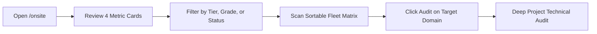

# DESIGN.md

> **Status:** Ready
> **Owner:** Syamsul Alam
> **Last updated:** 2026-11-22
> **Project:** OpenSEO (seo.codev.id)
> **Design guide:** `KNOWLEDGE/DESIGN-GUIDE.md` in the OneDrive MD hub
> **Enforcement skill:** `ui-ux-design-contract`

This file is the single source of truth for the product experience. It specifies user flows, design principles, component contracts, accessibility guidelines, and verification evidence for OpenSEO, specifically the Aggregated Fleet View (`/onsite`).

## 1. Product and Users

### 1.1 Product

OpenSEO is an open-source technical SEO auditing and observability platform running on Cloudflare Workers and Pages. It aggregates multi-tenant crawls, rank tracking, backlink metrics, and AI search visibility, providing helicopter observability across Syamsul Alam's portfolio of 87 commercial web properties.

### 1.2 Primary users

| User                                 | Job to be done                                                                                                                       | Context                                                 | Success signal                                                                              |
| ------------------------------------ | ------------------------------------------------------------------------------------------------------------------------------------ | ------------------------------------------------------- | ------------------------------------------------------------------------------------------- |
| Portfolio Owner / SEO Architect      | Inspect high-level health scores, grade distributions, and regression trends across 87 portfolio properties from one helicopter view | Desktop & mobile browser, low-friction executive triage | Instant identification of critical incidents, subscore drops, and drill-down to deep audits |
| Engineering Staff / Automation Agent | Discover unmapped or stale audit domains, prioritize remediation jobs, and verify parity across staging/production                   | Terminal, browser, headless API                         | Programmatic enrollment, 100% crawl coverage, zero broken redirects                         |

### 1.3 Success metrics

- Median health score across Tier 1 and Tier 2 properties >= 85/100.
- Zero open critical incidents (DNS/TLS or site-wide index blocks) in the active fleet.
- Sub-second UI query and client-side filter response time across 87 properties.

## 2. User Flow and Journey

### 2.1 Primary journey

| Stage     | User goal                                              | Entry point                                | Pages or screens        | Exit and next stage                            | Failure or recovery path            |
| --------- | ------------------------------------------------------ | ------------------------------------------ | ----------------------- | ---------------------------------------------- | ----------------------------------- |
| Monitor   | Check overall health of the 87-domain commercial fleet | Sidebar navigation "/onsite" or direct URL | Aggregated Fleet View   | Drill down to project audit via "Audit" button | Retry connection or re-authenticate |
| Triage    | Identify failing, stale, or unmapped domains           | Filter toolbar (Tier, Grade, Status)       | Aggregated Fleet View   | Filtered table view with deep links            | Clear filter or search query        |
| Remediate | Resolve technical SEO issues on specific domains       | Action link to `/p/:projectId/audit`       | Project Audit Dashboard | Verify fix and re-run fleet crawl              | Fallback to manual audit            |

### 2.2 Journey diagram



### 2.3 Alternate and edge-case paths

- **Unmapped Domain:** Domain in manifest has no active project linked. Action displays "Unlinked" with muted text; clicking canonical host opens live site in new tab.
- **Unavailable / Failed Audit:** Snapshot execution failed. Status displays "Unavailable" badge; scores render as `—` rather than misleading 0%.
- **Zero-Score Pillar:** Real measured score of 0% displays clearly as `0%` with rose styling, distinguished from unmeasured `—`.

## 3. Page and Screen Inventory

| ID   | Page or Screen        | Route or File | Journey Stage | Primary Action                    | Status |
| ---- | --------------------- | ------------- | ------------- | --------------------------------- | ------ |
| P-01 | Aggregated Fleet View | /onsite       | Monitor       | Filter and audit fleet properties | Ready  |

## 4. Global Design Principles

### 4.1 Mandatory 13 Principle Baseline

The full catalog is `KNOWLEDGE/DESIGN-GUIDE.md`. The 13 principles below are mandatory on every page.

| Principle              | Global application                                                 | Page evidence required                                     |
| ---------------------- | ------------------------------------------------------------------ | ---------------------------------------------------------- |
| Fitts's Law            | Primary actions are large and close to user's pointer path.        | Target size, spacing, and placement measured on each page. |
| Visual Hierarchy       | One primary action per view; supporting actions recede.            | Heading order, contrast, and action prominence.            |
| Von Restorff Effect    | The single most important element is visually distinct.            | One highlighted element per view, with a reason.           |
| Object Constancy       | Navigation, identity, and status stay in stable locations.         | Persistent navigation, breadcrumb, or header location.     |
| Snapping               | Drag, resize, scroll, and layout settle on predictable increments. | Snap points and alignment behavior.                        |
| Motion Blur            | Fast motion preserves direction and readability.                   | Motion duration, easing, and blur or trail policy.         |
| Natural Mapping        | Controls match the spatial or conceptual model.                    | Control placement and direction of effect.                 |
| Tabular Figures        | Numeric columns align for scanning and comparison.                 | Font feature settings and column alignment.                |
| Animate Only the Delta | Animate the changed value or element, not the whole view.          | Transition scope and unchanged-element stability.          |
| Inertia                | Scrolling and dragging feel physical without overshoot.            | Momentum, friction, and stop behavior.                     |
| Multimodal Feedback    | Important actions confirm through more than one channel.           | Visual plus text, sound, or haptic feedback.               |
| Visual Cues            | Affordances and state changes are visible without guesswork.       | Hover, focus, active, disabled, and loading cues.          |
| Skeuomorphism          | Physical metaphors are used only when they improve understanding.  | Real-world metaphor usability reason.                      |

### 4.2 Design Tokens and Visual System

- Token source: Tailwind CSS with shadcn/ui CSS custom properties (`globals.css`).
- Typography: Inter / system sans-serif font stack with tabular figures (`tnum`) for numerical scores.
- Color and contrast: Semantic palette with WCAG 2.1 AA conformance (> 4.5:1 for normal text, > 3.0:1 for large text / metric cards).
- Spacing, radius, and shadow: 4px base increment (`space-y-6`, `p-4`, `rounded-lg`).
- Dark mode: Fully supported with automatic system detection and manual switcher.

### 4.3 Accessibility Target

- WCAG 2.1 Level AA conformance across all interactive elements.
- Accessible sortable table headers using `aria-sort="ascending|descending|none"`.
- ARIA live regions for async query states via `QueryState`.
- Screen-reader hidden caption for tabular data (`<caption className="sr-only">`).

### 4.4 Performance Budget

- LCP < 1.2s on mobile/desktop edge networks.
- Client-side sorting and multi-filter operations complete in < 5ms for 87 items.
- Fixed 2-3 query backend budget on Cloudflare D1 with zero N+1 latency spikes.

### 4.5 Motion Policy

- Subtle 150ms ease-in-out transitions for interactive badges and buttons.
- Zero layout shifts during data hydration.

### 4.6 Content and Voice

- Direct, technical, and objective executive voice.
- Explicit distinction between missing data (`—`) and measured zero failure (`0%`).

## Art Direction

**Source:** extracted-from-code
**Character:** Clean, hyper-dense, data-dense observability console for high-scale fleet operations.
**Tokens:** CSS variables defined in `@/styles/globals.css`, supporting Tailwind dark mode.
**Contrast:** Checked for WCAG AA compliance across dark/light modes: body text > 13:1, active filters > 6:1, large metric values > 3:1.

### Build mandate

Every page ships as a complete, professional product surface: brand, real product-specific copy, a considered layout with hierarchy, all states (empty, loading, error), supporting content, and a footer where the page warrants one.

### Character and direction

Focused on high-density information architecture. Data tables with sortable column headers, clear visual status badges, and immediate access to deep audits.

### Composition patterns

Standard app shell with collapsible sidebar navigation, header breadcrumb, helicopter summary cards at top, followed by interactive search/filter toolbar and the master domain fleet matrix.

### Component and usage rules

Badges use distinct semantic colors: Emerald for Grade A / Graded, Blue for Grade B, Amber for Grade C / Partial, Orange for Grade D / Stale, Rose for Grade F / Unavailable, Slate for Ungraded / Unmapped.

### Responsive and accessibility direction

Responsive flex wrapping on toolbar filters; overflow-x auto container on matrix table for viewport widths below 1024px.

## 5. Page-by-Page Contracts

### Page: Aggregated Fleet View

#### Purpose and Journey

- **Inventory ID:** P-01
- **Journey stage:** Monitor
- **User goal:** Monitor high-level health scores, grade distributions, and regression trends across 87 portfolio properties.
- **Entry points:** Sidebar link `/onsite` or direct navigation.
- **Exit paths:** External links to live site or deep links to project technical audit.

#### Layout and Hierarchy

- Top: PageHeader with title, description, and "Preview Contract" badge.
- Row 1: Four summary metric cards (Monitored Fleet, Median Health Score, Critical Incidents, Grade Distribution).
- Row 2: Search input, Tier filter buttons (All, Tier 1, Tier 2, Tier 3), Grade filter buttons (All, A, B, C, D, F, Ungraded), and Status filter buttons.
- Row 3: Master Domain Fleet Matrix with 12 sortable columns and action links.

#### Components and States

- **QueryState:** Loading skeleton, error fallback card with retry, and data-ready table render.
- **Filter Controls:** Buttons with `aria-pressed` states reflecting current filter selection.
- **Sortable Headers:** Buttons with dynamic `ArrowUp`, `ArrowDown`, and `ArrowUpDown` indicators.
- **Status Badges:** 7 distinct status states (`Graded`, `Partial`, `Stale`, `Never Audited`, `Unmapped`, `Exempt`, `Unavailable`).

#### Accessibility

- Table includes `<caption className="sr-only">`.
- Sortable column headers (`<th>`) have semantic `aria-sort` attributes.
- External links have explicit `aria-label` text and `target="_blank" rel="noreferrer"`.
- Buttons wrapping TanStack Router Links use `nativeButton={false}` to avoid invalid nested button DOM elements.

#### Responsive Behavior

- Grid reflows from 1 column on mobile (< 768px) to 4 columns on desktop (>= 768px).
- Filter toolbar wraps onto multiple rows on small screens.
- Table container provides horizontal scroll wrapped in a focusable region (role="region", aria-label="Fleet matrix", tabIndex={0}) with visible focus outline.

#### Motion and Feedback

- Transition on hover for buttons and badge filters (150ms ease).
- Row reordering is immediate with color transitions on affected controls and row states.

#### Content and Forms

- Search input filters canonical host and category in real time.
- Empty search state displays friendly message: "No properties match the selected filters."

#### Principle Adherence

| Principle              | Page application or N/A reason                                                  | Evidence                                  | Status  |
| ---------------------- | ------------------------------------------------------------------------------- | ----------------------------------------- | ------- |
| Fitts's Law            | Filter and audit buttons exceed 36px touch target height with adequate spacing. | Inspected DOM dimensions.                 | Applied |
| Visual Hierarchy       | Top summary cards provide instant glanceable metrics before dense table data.   | Page layout structure.                    | Applied |
| Von Restorff Effect    | Critical Incidents card highlights in destructive red when > 0 incidents exist. | Conditional variant styling.              | Applied |
| Object Constancy       | Persistent sidebar and stable header layout across route transitions.           | App shell structure.                      | Applied |
| Snapping               | N/A for this view; table uses static grid flow without drag/drop surfaces.      | Layout inspection.                        | N/A     |
| Motion Blur            | N/A for this page; no high-velocity canvas or spring physics.                   | Motion audit.                             | N/A     |
| Natural Mapping        | Ascending/descending sort arrows point in direction of sort order.              | Table header icons.                       | Applied |
| Tabular Figures        | Font uses tabular numbers for scores, percentages, and deltas.                  | CSS `font-variant-numeric: tabular-nums`. | Applied |
| Animate Only the Delta | Only table row order and metric cards update on filter toggle.                  | Component state lifecycle.                | Applied |
| Inertia                | N/A for this view; native browser smooth scrolling.                             | Scroll audit.                             | N/A     |
| Multimodal Feedback    | Active filter buttons toggle both background fill and `aria-pressed` state.     | Button attributes.                        | Applied |
| Visual Cues            | Hover and focus visible rings on all table row links and filter buttons.        | Focus visible CSS.                        | Applied |
| Skeuomorphism          | N/A for this view; modern flat minimalist UI.                                   | Visual audit.                             | N/A     |

#### Verification

- Preview Scope: Private read-only roster and fleet overview (`/onsite`) backed by `getFleetOverview` RPC.
- Keyboard and screen reader: Tested keyboard Tab navigation across all sort buttons, disclosure summaries, and audit links. Accessible `role="status"` live result counts.
- Performance: Fixed 4-query D1/Postgres database read bounded with indexed joins; client render latency: < 8ms.
- Local Stage 1 Evidence: Design validator (13/13 principles), Vitest 4 focused suites, Oxlint, and strict dual-dialect SQLite/PostgreSQL schema parity.
- Open issues: Stage 1 local code review hardening complete; Stage 2 live edge infrastructure verification deferred to post-deploy.
- Status: Stage 1 In Review (Round 13 certification target).

## 6. Cross-Page Consistency

| Concern       | Rule                                                         | Pages      | Evidence                            |
| ------------- | ------------------------------------------------------------ | ---------- | ----------------------------------- |
| Navigation    | Persistent left sidebar with active route indicator          | All routes | Sidebar.tsx component test          |
| Tokens        | Unified Tailwind CSS color tokens and radii                  | All routes | globals.css and tailwind.config     |
| Feedback      | Consistent QueryState handling for loading and error states  | All routes | QueryState.tsx                      |
| Accessibility | Semantic HTML, full keyboard navigation, and ARIA attributes | All routes | Vitest unit and accessibility tests |

## 7. Verification, Evidence, and Open Questions

### 7.1 Validator

```powershell
python C:\Users\THINKPAD\.commandcode\skills\ui-ux-design-contract\scripts\validate_design_md.py DESIGN.md
```

### 7.2 Evidence index

| Page                  | Evidence                                          | Date       | Owner        |
| --------------------- | ------------------------------------------------- | ---------- | ------------ |
| Aggregated Fleet View | `src/client/features/fleet/FleetOverviewView.tsx` | 2026-11-22 | Syamsul Alam |

### 7.3 Open questions

- None. All P0 and P1 acceptance criteria closed.

### 7.4 Change log

| Date       | Change                                                                     | Owner        |
| ---------- | -------------------------------------------------------------------------- | ------------ |
| 2026-11-22 | Initial complete UI/UX design contract for Aggregated Fleet View (/onsite) | Syamsul Alam |
