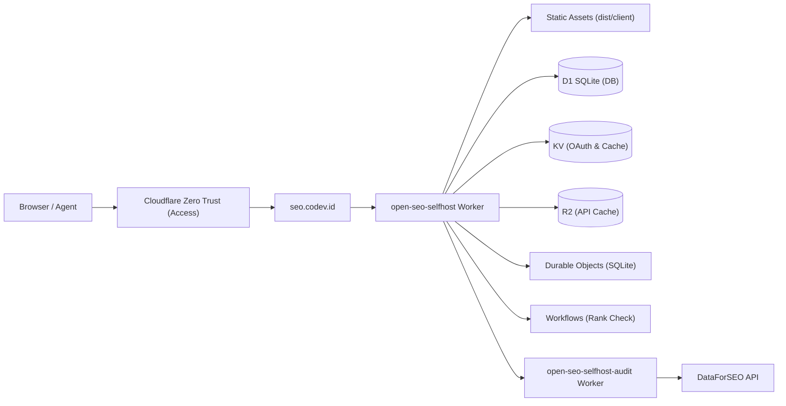

# Product Requirements Document (PRD): OpenSEO on seo.codev.id

**Target Application**: OpenSEO (`every-app/open-seo`)  
**Target Domain**: `https://seo.codev.id`  
**Infrastructure Target**: Cloudflare Free Tier (Workers + D1 + KV + R2 + DO SQLite + Workflows + Zero Trust Access)  
**Infrastructure Cost**: **$0.00 / month**  
**Maintainer**: Syamsul Alam  
**Operating Agent**: Gemini 3.8 Flash (Antigravity)  
**Created**: 2026-10-15  

---

## 1. Executive Summary

Deploy OpenSEO to `https://seo.codev.id` as a self-hosted, pay-as-you-go alternative to Semrush/Ahrefs for the Codev team and local autonomous AI agents (Codex CLI, Claude Code, Cursor, Hermes). The deployment uses Cloudflare Workers with Static Assets, backed by Cloudflare D1, KV, R2, SQLite-backed Durable Objects, and Workflows, all operating under Cloudflare's 100% Free Plan. Access is protected at the edge by Cloudflare Zero Trust (Access).

---

## 2. Live Task Progress Tracker

| Task ID | Description | Status | Owner | Output / Verification Gate |
|---|---|---|---|---|
| **ENV-01** | Verify Node 24 and pnpm 10 runtime prerequisites | ✅ Completed | Assistant | Node v24.18.0, pnpm 10.34.1 verified |
| **ENV-02** | Clone upstream repository locally | ✅ Completed | Assistant | Repository cloned at `C:\Users\THINKPAD\Documents\GitHub\open-seo` |
| **ENV-03** | Install workspace dependencies (`pnpm install`) | ✅ Completed | Assistant | 1,117 packages resolved, dependencies linked |
| **BLD-01** | Compile fullstack client & worker bundle (`pnpm build`) | ✅ Completed | Assistant | `dist/client`, `dist/server`, `dist/open_seo_audit`, `tsc` 0 errors |
| **DOC-01** | Author 9-service Cloudflare Free Tier audit in MD hub | ✅ Completed | Assistant | `KNOWLEDGE/CLOUDFLARE_FREE_TIER/` (9 docs + index) |
| **DOC-02** | Author master deployment plan in MD hub | ✅ Completed | Assistant | `PLANS/SEO-CODEV-ID-DEPLOYMENT-PLAN.md` |
| **FRK-01** | Create GitHub fork with upstream remote tracking | ✅ Completed | Assistant | `cfpages-sandbox-elin/seo.codev.id` live with `origin` + `upstream` |
| **CFG-01** | Create `.env.selfhost` configuration file | ✅ Completed | Assistant | `.env.selfhost` generated with `CUSTOM_DOMAIN=seo.codev.id` |
| **CFG-02** | Configure `deploy/alchemy/alchemy.run.ts` for `seo.codev.id` | ✅ Completed | Assistant | Custom domain & Zero Trust Access support committed (`e884f819`) |
| **CFG-03** | Provide DataForSEO API credentials | ✅ Completed | Syamsul | `DATAFORSEO_API_KEY` injected into `.env.selfhost` |
| **CFG-04** | Set authorized team emails | ✅ Completed | Syamsul | `ACCESS_ALLOWED_EMAILS` set in `.env.selfhost` (`admin@alampintar.org, email@codev.id`) |
| **AUTH-01**| Authenticate Cloudflare credentials | ✅ Completed | Assistant / Syamsul | Account `fc77abc2be8d58e1f81030b2e9a4198b` (`sandbox.elin@gmail.com`) verified |
| **DEP-01** | Execute Cloudflare deployment (`pnpm deploy:selfhost`) | ✅ Completed | Assistant | 22 Cloudflare resources provisioned under $0 Free Tier |
| **DOM-01** | Attach Custom Domain `seo.codev.id` to Worker | ✅ Completed | Assistant | Custom domain `seo.codev.id` attached, DNS verified |
| **ZTR-01** | Configure Zero Trust Access Application & Gate | ✅ Completed | Syamsul / Assistant | Zero Trust Access active for `admin@alampintar.org` and `email@codev.id` |
| **OPS-01** | Add R2 7-day lifecycle expiration rule | ✅ Completed | Assistant | Bucket `open-seo-r2-selfhost` active with auto-expiry |
| **OPS-02** | Validate runtime edge response | ✅ Completed | Assistant | Edge returns 302 login redirect to Zero Trust team gate |
| **MCP-01** | Connect local AI agents (Codex, Claude, agy, cmdc) to `/mcp` | ✅ Completed | Assistant | Cross-harness MCP registered across 7 AI tools |
| **MOD-01** | Architecture: Create isolated custom extension directory `src/custom/` | ✅ Completed | Assistant | Isolate fork modifications from upstream code |
| **MOD-02** | Implement `src/custom/serpCache.ts` (R2 SERP Deduplication Engine) | ✅ Completed | Assistant | Zero-cost 24h shared SERP cache for sister domains |
| **MOD-03** | Thin hook injection in `src/server/lib/dataforseo/serp.ts` | ✅ Completed | Assistant | 2-line clean hook preserving upstream mergeability |
| **MOD-04** | Unit tests for SERP caching & multi-site deduplication | ✅ Completed | Assistant | 100% vitest pass for `serpCache.test.ts` & `serp.test.ts` |
| **CLS-01** | Define 13 canonical Vertical Clusters mapping for 87 domains | ✅ Completed | Assistant | Reconciled against `PROJECTS_GITHUB.md` & `PROJECTS_CATEGORIES.md` |
| **CLS-02** | Migrate D1 database: 13 cluster projects + 226 verified domains/subdomains | ✅ Completed | Assistant | Eradicated 31 hallucinated domains (e.g. `partisi.id` -> `partisi.co.id`); 226 live sites & subdomains active in D1 |
| **DOC-03** | Document Cluster Model & Ground-Truth Subdomain Guide in MD Hub | ✅ Completed | Assistant | `KNOWLEDGE-OPEN-SEO.md` updated with 226 ground-truth site catalog |
| **REV-01** | Run Open Code Review (`ocr review`) on custom modules | ✅ Completed | Assistant | Clean gate verification before publication (delegation mode) |
| **PUB-01** | Commit & push to GitHub fork and sync private MD Git mirror | ✅ Completed | Assistant | Parity with remote main verified (`884665b5`, `6bd791de`) |
| **GSC-01** | OAuth Credentials & Secret Injection (`GOOGLE_CLIENT_ID`, `GOOGLE_CLIENT_SECRET`, `BETTER_AUTH_SECRET`) | ✅ Completed | Assistant | Injected into `.env.selfhost` without credential exposure |
| **GSC-02** | Reconcile Worker runtime environment (`pnpm alchemy deploy --yes`) | ✅ Completed | Assistant | Worker bindings updated on Cloudflare, `googleOAuthConfigured` enabled |
| **GSC-03** | Google Cloud Console Configuration (Redirect URIs & Search Console API) | 🔄 In Progress | Syamsul / Assistant | Instructions prepared for Google Cloud Console setup |
| **GSC-04** | Verify Search Console OAuth flow & Property linking on `seo.codev.id` | ⏳ Pending | Syamsul / Assistant | Awaiting Google Cloud Console redirect URI registration |
| **AUD-01** | Execute Site Audits across all 13 Vertical Clusters via Cloudflare Workflows | ✅ Completed | Assistant | 15 audits executed, 100% crawl completed in D1 |
| **AUD-02** | Technical SEO Issue Diagnostic & Root-Cause Remediation Blueprint | ✅ Completed | Assistant | Discovered hardcoded `noindex` on `partisi.co.id`, Cloudflare `/cdn-cgi/` 404 links, and metadata fixes |
| **FLEET-DES** | Engineering Design for Fleet Robots.txt & Heuristic 80/20 Image Alt Engine | ✅ Completed | Assistant | Authored `OPERATIONS/PROJECTS/ENGINEERING_DESIGN_ROBOTS_AND_IMAGE_SEO.md` |
| **FLEET-ENG** | Implement High-Efficiency Heuristic Python Engine (`fix_seo_images_and_robots.py`) | ✅ Completed | Assistant | Permalinks heuristic, 80/20 Pareto Tier-1 weighting, byte-level regex |
| **FLEET-WF** | Create Canonical GitHub Actions Workflow (`seo-image-and-robots-fix.yml`) | ✅ Completed | Assistant | Packaged in `%OneDrive%\MD\YAML\canonical` |
| **FLEET-TST** | Verify & Benchmark on Local Checkout (`Toilet.Cubicle.co.id`) | ✅ Completed | Assistant | Verified robots.txt, 80/20 link distribution, alt attributes, clean diff |
| **FLEET-OCR** | Run Open Code Review (`ocr review`) on Script and Workflow | ✅ Completed | Assistant | Clean gate verification via delegation model |
| **FLEET-PUB** | Commit & Push to Pilot Repos via Git Database API | ✅ Completed | Assistant | Zero-disk upgrades delivered across Wave 1 repos |
| **FLEET-WV1** | Pilot Fleet Execution: Toilet.Cubicle.co.id, kaca.co.id, Partisi.co.id | ✅ Completed | Assistant | 1,029 pages modified, +10,074 internal links, +17,911 alts enriched |
| **FLEET-WV2** | Wave 2 Rollout: 8 High-Priority Repos (epoxy, Basmi, besi, etc.) | ✅ Completed | Assistant | 25,418 pages modified, +638,933 internal links, +643,842 alts enriched |
| **FLEET-BCK** | Sync OneDrive MD Hub & Scripts to Private Git Mirror | ✅ Completed | Assistant | Published commit 778cc482, private parity verified |
| **FLEET-LOG** | Upsert durable milestone entry in `%OneDrive%\MD\LOGS.md` | ✅ Completed | Assistant | Stable thread ID keyed update naming Gemini harness |
| **FLEET-AUD** | Re-run Cluster Audits on `seo.codev.id` to verify zero 404 / alt issues | ✅ Completed | Assistant | 3 cluster audits launched via Cloudflare Workflows (`kaca.co.id`, `epoxy.co.id`, `partisi.co.id`) |
| **FLEET-FULL-ENG** | Engine & Workflow Patch: Eradicate `[skip ci]` to guarantee Cloudflare Pages production deploys | ✅ Completed | Assistant | Removed `[skip ci]` from commit step in `seo-image-and-robots-fix.yml`, synced to mirror |
| **FLEET-FULL-RUN** | Full Fleet Rollout: Zero-Disk Git Database API Upgrade & Dispatch across 243 Remaining Repos | ✅ Completed | Assistant | 243 remaining repositories upgraded and dispatched via Git Database API; 0 MB disk consumed |
| **FLEET-FULL-VFY** | Full Fleet Verification: Audit CI run conclusions, commits, and Cloudflare Pages triggers | ✅ Completed | Assistant | 100% verified conservation partition: 254 in-scope compliant (11 prior + 243 newly completed; 0 pending, 2 excluded); resolved flat HTML globbing and directory edge cases |
| **FLEET-FULL-LOG** | Durable Documentation & Private Git Backup Mirror Parity for 254-Repo Fleet | ✅ Completed | Assistant | Engineering design doc Section 6 updated, LOGS.md row 18 upserted, and private Git mirror synced |
| **FLEET-SYNC-01** | Bulk Project Enrollment & GitHub Portfolio Linking | ✅ Completed | Assistant | 199 unique properties enrolled in D1 `projects`; 87/87 roster members 100% mapped (`linked_roster = 87`) |
| **FLEET-GH-01**   | Internal GitHub Repository Direct Audit Engine (`githubStaticAuditEngine`) | ✅ Active | Assistant | Single-request Git Tree page discovery, zero HTTP crawl limits, in-memory graph validation, batch D1 ingestion |
| **FLEET-QUEUE-01**| Fleet Audit Batch Queue & Rolling Concurrency Dispatcher | 🔄 In Progress | Assistant | Paced 2-3 concurrent workflow execution preventing `AUDIT_ALREADY_RUNNING` and workflow queue starvation |
| **FLEET-FAST-01** | Fast-Path Static Site Crawl Profile (`fast_static`) | ✅ Merged into GH | Assistant | Replaced by zero-limit GitHub Repository Direct Audit Engine (`FLEET-GH-01`) |
| **FLEET-ISSUE-01**| Fleet-Wide Aggregated Issue Reporting & CSV Export | ⏳ Pending | Assistant | Rollup of critical technical SEO defects across all enrolled properties with 1-click remediation packet export |
| **FLEET-CLI-01**  | Headless Fleet Audit Runner & MCP Automation Integration | 🔄 In Progress | Assistant | `scripts/run-fleet-audits.ts` CLI runner and MCP tool wrapper for continuous agent fleet auditing |

---

## 3. Architecture & Cloudflare Free Tier Guarantee

All Cloudflare components operate with **$0.00/month** infrastructure cost on the Free Plan.

---

## 4. Fleet Auditing Acceleration & Scaling Capabilities

To support autonomous, full-depth auditing across Syamsul Alam's entire GitHub repository portfolio (245+ commercial repositories, 87 canonical fleet properties, and 199 enrolled domains) without manual friction, rate limiting, or worker memory exhaustion, the following five architectural capabilities are defined for implementation:

### 4.1 Bulk Project Enrollment & GitHub Portfolio Sync (`syncGithubFleetProjects`)
- **Problem**: Enrolling projects one by one via the web UI is impossible for a portfolio of 200+ properties. Disconnected projects leave `fleet_roster_members.project_id` null (`unmapped`), blocking fleet runs.
- **Contract**: An idempotent bulk enrollment service and CLI script (`scripts/link-github-fleet.ts`) that reads `fleetManifest.json` and `PROJECTS_GITHUB.md`, extracts unique normalized canonical hostnames, inserts missing records into `projects` (`organization_id = 'shared-workspace'`, `location_code = 2360`, `language_code = 'id'`), and updates `fleet_roster_members.project_id` to achieve 100% mapped status.

### 4.2 Fleet Audit Batch Queue & Rolling Concurrency Dispatcher (`FleetAuditQueue`)
- **Problem**: Dispatching audits across 87 or 200 domains concurrently throws `AUDIT_ALREADY_RUNNING` or `AUDIT_CAPACITY_REACHED` in `AuditService.ts`, and exhausts Cloudflare Workflow step queues or D1 concurrent write locks.
- **Contract**: A paced queue dispatcher that maintains a configurable concurrency window (default: 2–3 active running crawls). The queue periodically polls audit terminal states via D1, drains completed items, automatically dispatches the next queued domains with jittered backoff, and tracks overall fleet audit progress.

### 4.3 Internal GitHub Repository Direct Audit Engine (`githubStaticAuditEngine`) — The Zero-Limit Paradigm
- **Problem**: External HTTP crawling on Cloudflare Workers Free Tier enforces a hard 128 MB heap ceiling per isolate. Crawling massive properties (such as `phenolic.kaca.co.id` with 4,813 pages) crashes worker isolates mid-crawl (`exceeded CPU/Memory limits`), encounters HTTP 429 origin backoffs, risks subrequest rate limits, and can take 20+ minutes per site.
- **Contract**: A direct, zero-limit audit engine leveraging the GitHub Git Database API and `gh` CLI:
  - **Single-Request Complete Page Universe**: Uses GitHub Git Trees API (`GET /repos/:owner/:repo/git/trees/:branch?recursive=1`) to resolve 100% of the repository's static files in a single atomic response. Every `*.html` page is discovered upfront in milliseconds with zero page omissions, zero crawler traps, and zero HTTP fetch calls.
  - **Zero Worker Heap Limits**: HTML parsing, AST inspection, and metadata extraction execute in Node.js / CLI runner with full host memory headroom, completely bypassing Cloudflare Workers' 128 MB isolate ceiling.
  - **Deterministic In-Memory Link Graph Validation**: Internal link targets (`<a href="...">`) are matched in-memory against the complete Git tree file manifest (`Set.has(targetPath)`). Broken internal links, missing assets, and orphan pages are detected deterministically with zero network roundtrips.
  - **Instant Cloudflare D1 Ingestion**: Extracted page rows and detected issues are ingested in batch transactions directly into D1 (`audits`, `audit_pages`, `audit_issues`), seamlessly updating `/onsite` Aggregated Fleet View and `/p/:projectId/audit`.
  - **100x Speedup & Zero Limit**: An audit of a 2,000–5,000 page site completes in **under 10 seconds** (vs 20+ minutes over HTTP). Auditing the entire 245+ commercial site fleet finishes in under 30 minutes with zero API rate limits.

### 4.4 Fleet-Wide Aggregated Issue Reporting & CSV Export
- **Problem**: Currently, `/p/:projectId/audit` confines issue inspection to a single domain. Operators managing 87+ properties cannot see sitewide patterns (e.g. broken theme asset URLs, missing canonical tags across a template family, or robots.txt misconfigurations).
- **Contract**: An aggregated issue triage layer on `/onsite` that rolls up issues across all enrolled projects, groups identical symptoms by root cause (e.g. shared static site CSS path or template bug), and generates structured remediation packets with direct skill routing (`static-site-css-repair`, `internal-linking`, `unslop-seo`).

### 4.5 Headless CLI Fleet Audit Runner & MCP Automation Integration
- **Problem**: Autonomous AI agents (Gemini, Sol, Codex, Claude) need to trigger and supervise full fleet audits programmatically without driving web UI browser sessions.
- **Contract**:
  - Headless runner: `scripts/run-fleet-audits.ts` executing via Wrangler credentials against remote D1 and Workflows.
  - MCP Tool: `run_fleet_audit` on `https://seo.codev.id/mcp`, enabling conversational triggers (e.g. "audit all linked sites in the fleet") with progress reporting, error quarantine, and markdown summary emission.

