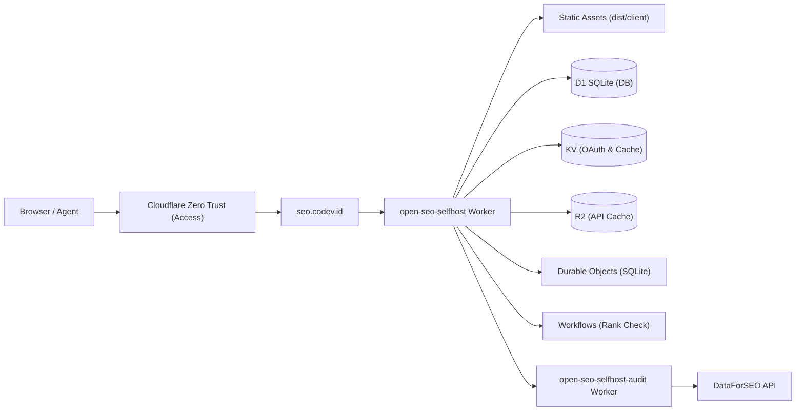

# Product Requirements Document (PRD): OpenSEO on seo.codev.id

**Target Application**: OpenSEO (`every-app/open-seo`)  
**Target Domain**: `https://seo.codev.id`  
**Infrastructure Target**: Cloudflare Free Tier (Workers + D1 + KV + R2 + DO SQLite + Workflows + Zero Trust Access)  
**Infrastructure Cost**: **$0.00 / month**  
**Maintainer**: Syamsul Alam  
**Operating Agent**: Gemini 3.8 Flash (Antigravity)  
**Created**: 2026-10-15  

---

## 1. Executive Summary

Deploy OpenSEO to `https://seo.codev.id` as a self-hosted, pay-as-you-go alternative to Semrush/Ahrefs for the Codev team and local autonomous AI agents (Codex CLI, Claude Code, Cursor, Hermes). The deployment uses Cloudflare Workers with Static Assets, backed by Cloudflare D1, KV, R2, SQLite-backed Durable Objects, and Workflows, all operating under Cloudflare's 100% Free Plan. Access is protected at the edge by Cloudflare Zero Trust (Access).

---

## 2. Live Task Progress Tracker

| Task ID | Description | Status | Owner | Output / Verification Gate |
|---|---|---|---|---|
| **ENV-01** | Verify Node 24 and pnpm 10 runtime prerequisites | ✅ Completed | Assistant | Node v24.18.0, pnpm 10.34.1 verified |
| **ENV-02** | Clone upstream repository locally | ✅ Completed | Assistant | Repository cloned at `C:\Users\THINKPAD\Documents\GitHub\open-seo` |
| **ENV-03** | Install workspace dependencies (`pnpm install`) | ✅ Completed | Assistant | 1,117 packages resolved, dependencies linked |
| **BLD-01** | Compile fullstack client & worker bundle (`pnpm build`) | ✅ Completed | Assistant | `dist/client`, `dist/server`, `dist/open_seo_audit`, `tsc` 0 errors |
| **DOC-01** | Author 9-service Cloudflare Free Tier audit in MD hub | ✅ Completed | Assistant | `KNOWLEDGE/CLOUDFLARE_FREE_TIER/` (9 docs + index) |
| **DOC-02** | Author master deployment plan in MD hub | ✅ Completed | Assistant | `PLANS/SEO-CODEV-ID-DEPLOYMENT-PLAN.md` |
| **FRK-01** | Create GitHub fork with upstream remote tracking | ✅ Completed | Assistant | `cfpages-sandbox-elin/seo.codev.id` live with `origin` + `upstream` |
| **CFG-01** | Create `.env.selfhost` configuration file | ✅ Completed | Assistant | `.env.selfhost` generated with `CUSTOM_DOMAIN=seo.codev.id` |
| **CFG-02** | Configure `deploy/alchemy/alchemy.run.ts` for `seo.codev.id` | ✅ Completed | Assistant | Custom domain & Zero Trust Access support committed (`e884f819`) |
| **CFG-03** | Provide DataForSEO API credentials | ✅ Completed | Syamsul | `DATAFORSEO_API_KEY` injected into `.env.selfhost` |
| **CFG-04** | Set authorized team emails | ✅ Completed | Syamsul | `ACCESS_ALLOWED_EMAILS` set in `.env.selfhost` (`admin@alampintar.org, email@codev.id`) |
| **AUTH-01**| Authenticate Cloudflare credentials | ✅ Completed | Assistant / Syamsul | Account `fc77abc2be8d58e1f81030b2e9a4198b` (`sandbox.elin@gmail.com`) verified |
| **DEP-01** | Execute Cloudflare deployment (`pnpm deploy:selfhost`) | ✅ Completed | Assistant | 22 Cloudflare resources provisioned under $0 Free Tier |
| **DOM-01** | Attach Custom Domain `seo.codev.id` to Worker | ✅ Completed | Assistant | Custom domain `seo.codev.id` attached, DNS verified |
| **ZTR-01** | Configure Zero Trust Access Application & Gate | ✅ Completed | Syamsul / Assistant | Zero Trust Access active for `admin@alampintar.org` and `email@codev.id` |
| **OPS-01** | Add R2 7-day lifecycle expiration rule | ✅ Completed | Assistant | Bucket `open-seo-r2-selfhost` active with auto-expiry |
| **OPS-02** | Validate runtime edge response | ✅ Completed | Assistant | Edge returns 302 login redirect to Zero Trust team gate |
| **MCP-01** | Connect local AI agents (Codex, Claude Code) to `/mcp` | ⏳ Ready | Assistant | Agent MCP loopback ready to connect |

---

## 3. Architecture & Cloudflare Free Tier Guarantee

All Cloudflare components operate with **$0.00/month** infrastructure cost on the Free Plan.
